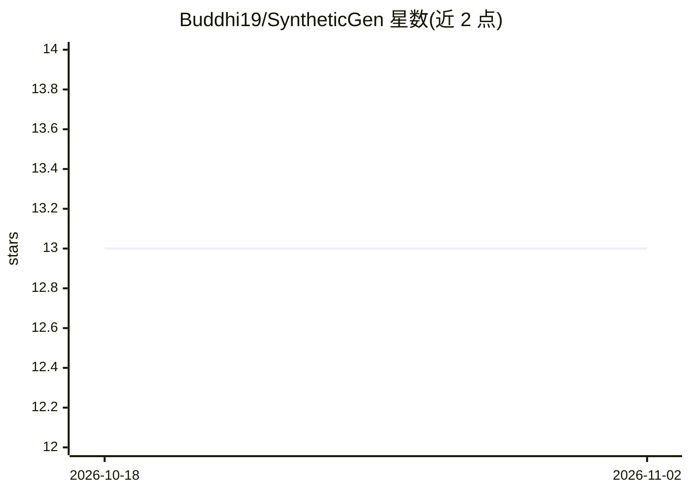

# Buddhi19/SyntheticGen

⭐ 13 · Python · MIT · 推送 2026-08-27 · [GitHub](https://github.com/Buddhi19/SyntheticGen) · [官网](https://buddhi19.github.io/SyntheticGen/) · 组织维护

**生成可控类别比例的遥感分割合成数据（扩散模型）**

IGARSS 2026 论文的官方实现：针对 LoveDA 遥感语义分割数据集的长尾分布问题，用两阶段扩散管线生成合成数据——第一阶段为带类别比例条件的 D3PM 布局生成器，第二阶段用 ControlNet 将布局渲染为遥感图像。用户可显式指定各类地物占比（如 building:0.4）与 Urban/Rural 域条件，实验由 YAML/JSON 配置驱动。提供训练与采样脚本，权重与预生成合成数据集发布于 Hugging Face，MIT 许可。面向遥感与计算机视觉科研用户。

## 筛选速览

| 维度 | 判定 | 备注 |
|---|---|---|
| AI 角色 | `ai-native` | 本体是模型或模型工具 |
| 许可风险 | `permissive` | MIT |
| 部署形态 | `library` | 以包/库形式分发 |
| 模型依赖 | — | README 未给出锁定关系 |
| 硬件要求 | — | 无带数字的原话,不猜 |
| 安装摩擦 | `low` | 无编译、无系统依赖或容器化 |
| 成熟度 | — | 结构信号不足 |

## 能力要点

- 两阶段管线：比例条件 D3PM 布局生成 + ControlNet 图像合成
- 支持完整或稀疏类别比例控制（如 building:0.4）与域条件
- 配置驱动的工作流，训练与采样均由 YAML/JSON 配置复现
- 论文所用权重与预生成合成数据集发布于 Hugging Face

## 适用场景

- 为长尾分布的遥感分割数据集定向补充稀有类样本
- 按指定地物比例与域（Urban/Rural）生成合成训练图像
- 复现论文中类别不平衡与域偏移下的增强实验

## 场景标签

`图像生成` · 领域:内容生成

## 证据(README 行号)

> L17: **SyntheticGen** tackles the long-tail distribution problem in LoveDA by generating synthetic imagery with *explici
> L26: - Two-stage pipeline: ratio-conditioned layout D3PM + ControlNet image synthesis.

## 星数曲线

2026-10-18 13 → 2026-11-02 13（+0）

---
*卡片 v1 · prompt 1.4 · 生成 2026-10-31 · 置信度 mid · 依据 README sha `611f4201a12d` · [字段定义](../../DATASET.md)*
