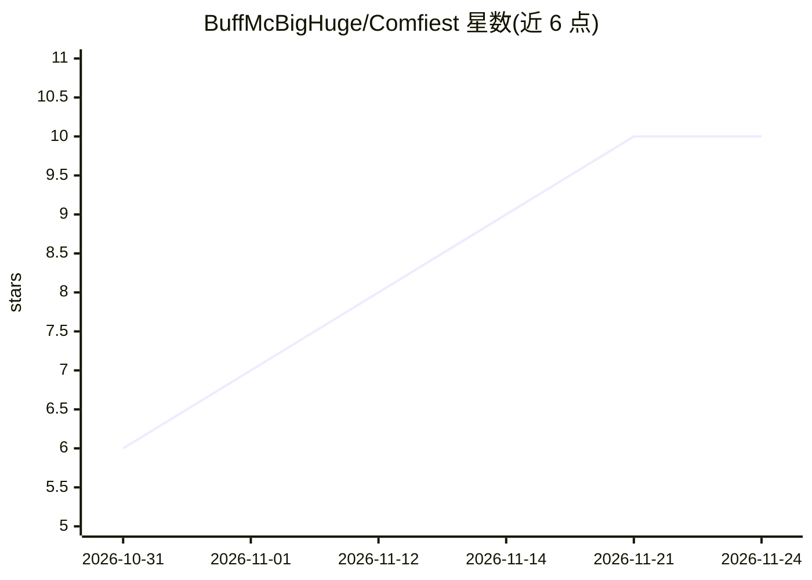

# BuffMcBigHuge/Comfiest

⭐ 10 · Python · MIT · 推送 2026-11-21 · [GitHub](https://github.com/BuffMcBigHuge/Comfiest) · [官网](https://Comfie.st) · 个人维护

**让 AI Agent 在自有 GPU 上运行 ComfyUI 图像/视频/语音/音乐工作流的生产套件**

本地优先的 ComfyUI 工作流仓库：提供模型路由表、可运行的 workflow 模板（UI JSON 与 API JSON 镜像）、硬件限制标注、提交/轮询/收集循环与输出溯源（prompt_id 目录+run-log）。主接口是 Agent：将仓库接入支持 MCP 的客户端（Claude Code、OpenCode、Codex、Cursor 等），由 Agent 安装 ComfyUI 与节点包、注册 comfy-mcp 服务器、选择工作流并提交运行。通过 comfy-mcp（基于 comfy-cli 的 stdio 服务器）与 ComfyUI 通信，全部使用开放权重模型，无 API key 与积分消耗。

## 筛选速览

| 维度 | 判定 | 备注 |
|---|---|---|
| AI 角色 | `ai-ecosystem` | LLM/agent 周边工具 |
| 许可风险 | `permissive` | MIT |
| 部署形态 | `library` | 以包/库形式分发 |
| 模型依赖 | — | README 未给出锁定关系 |
| 硬件要求 | — | 无带数字的原话,不猜 |
| 安装摩擦 | `low` | 无编译、无系统依赖或容器化 |
| 成熟度 | — | 结构信号不足 |

## 能力要点

- MCP 桥接（comfy-mcp + comfy-cli）让编码 Agent 提交/轮询/收集工作流
- 覆盖文本生成图像、图像编辑、语音、音乐、视频、升采样、无缝循环、分割的工作流目录
- 按硬件能力的模型路由，标注 24 GB 显卡与高内存需求的重负载模型
- 输出按 prompt_id 归档并写入 run-log，保证溯源

## 适用场景

- 让 Agent 在本地 GPU 上自动运行文生图/文生视频工作流
- 批量生成带同步音频的视频并做 2K/4K 升采样
- 用 Fish Audio Drama 3 做语音与声音克隆、用 YuE2/Music 3 生成歌曲

## 场景标签

`图像生成` `视频生成` `语音合成` `图像视频处理` · 领域:内容生成

## 证据(README 行号)

> L12:  A local-first, open-weights video production suite for ComfyUI — driven by your agent.
> L59: small traps that waste a render. Point a coding agent at this repository and it can set up the MCP
> L91: 3. Install/register the `comfy-*` MCP server for your ComfyUI host using `MCP-SETUP.md`.

## 星数曲线

2026-10-31 6 → 2026-11-24 10（+4）

---
*卡片 v1 · prompt 1.4 · 生成 2026-11-20 · 置信度 high · 依据 README sha `01ca94e7252d` · [字段定义](../../DATASET.md)*
