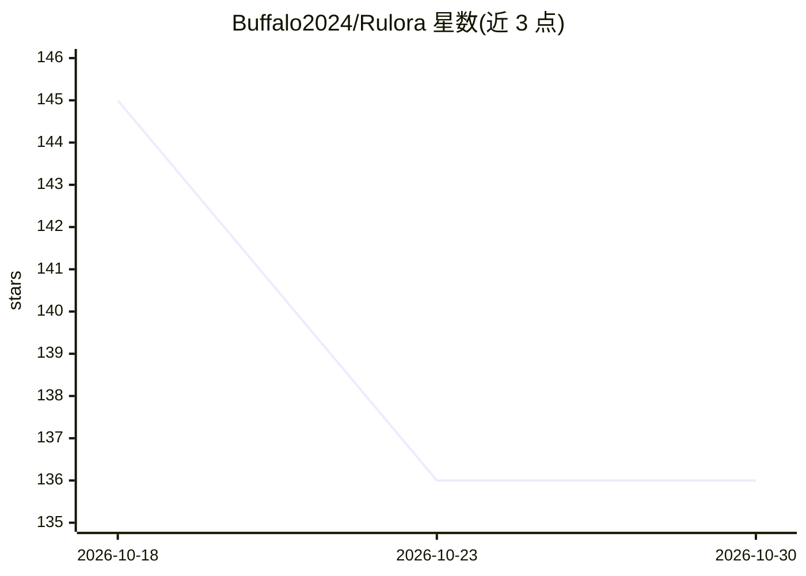

# Buffalo2024/Rulora

⭐ 136 · JavaScript · Apache-2.0 · 推送 2026-10-14 · [GitHub](https://github.com/Buffalo2024/Rulora) · 个人维护 · 中文 README

**可嵌入 AI Agent 的控制组件：输出校验、有界循环与群体决策冻结**

以 Hybrid 协作思路为现有 AI Agent 提供控制层的 Node.js 组件库：OutputBoundary 拒绝缺字段或未知引用的输出，LoopControl 在连续无进展时停止并转人工，CollectiveControl 冻结候选快照、限制 Reviewer 只能选择已有 ID。Core 运行时零依赖，要求 Node.js 20+，通过 npm 以 alpha 标签安装，示例无需 API Key 与联网模型调用。当前版本为 0.1.0-alpha.4，Core 只内置内存 Repository，不含持久化、认证与生产级调度。

## 筛选速览

| 维度 | 判定 | 备注 |
|---|---|---|
| AI 角色 | `ai-ecosystem` | LLM/agent 周边工具 |
| 许可风险 | `permissive` | Apache-2.0 |
| 部署形态 | `library` | 以包/库形式分发 |
| 模型依赖 | — | README 未给出锁定关系 |
| 硬件要求 | — | 无带数字的原话,不猜 |
| 安装摩擦 | `low` | 无编译、无系统依赖或容器化 |
| 成熟度 | `idea` | |

## 能力要点

- 三个控制组件：OutputBoundary、LoopControl、CollectiveControl
- Core 运行时零依赖（Ajv/TypeScript 仅为开发依赖）
- 离线示例无需 API Key，可复现输出拒绝、循环停止与候选冻结行为
- 提供状态机、MemoryRepository 与顺序 HybridPipeline

## 适用场景

- 为现有 Agent 增加输出结构与证据引用校验
- 在多席群体决策中冻结候选并限制复核选择范围
- 在连续无进展的循环达到上限时停止并转人工处理

## 场景标签

`Agent 框架` `多智能体` · 领域:Agent 开发

## 证据(README 行号)

> L4:  可嵌入现有 AI Agent 的开源控制组件。
> L7: Rulora 通过模型与程序的 **Hybrid 协作**，约束输出、控制循环、管理状态与群体候选选择。
> L101: 网络重连、约束修订、业务交换分别计数。Core 提供计数与停止状态，宿主执行调度；

## 星数曲线

2026-10-18 145 → 2026-10-30 136（-9）

---
*卡片 v1 · prompt 1.4 · 生成 2026-10-23 · 置信度 high · 依据 README sha `68762c003ac0` · [字段定义](../../DATASET.md)*
