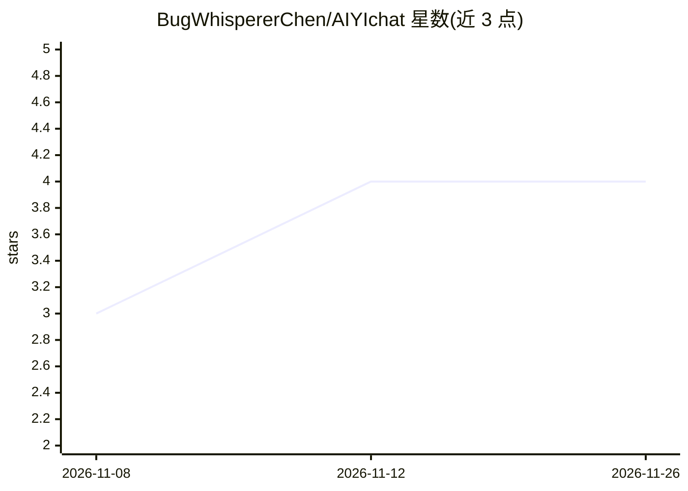

# BugWhispererChen/AIYIchat

⭐ 4 · Python · MIT · 推送 2026-11-19 · [GitHub](https://github.com/BugWhispererChen/AIYIchat) · 个人维护 · 中文 README

**自托管 AI 聊天服务平台：一人一台机即可运营 QQ/微信 AI 陪伴服务**

基于 Python 3.11 + FastAPI + MongoDB 的自托管平台，运营者侧提供服务台账（身份×渠道×角色）、QQ/微信/网页三渠道多 Bot 并发、按 Token/语音/图片计量的套餐订单、注册审核与 IP 限流、离线评测与可观测看板；终端用户侧是住在 QQ/微信里的 AI 陪伴，具备五级记忆、11 类情绪判定、主动关怀调度、声音复刻与表情包媒体库。模型经 OpenAI 兼容接口接入，按 12 个任务槽位配置凭证组；无第三方支付接入，单管理员无权限分级。

## 筛选速览

| 维度 | 判定 | 备注 |
|---|---|---|
| AI 角色 | `ai-native` | 本体是模型或模型工具 |
| 许可风险 | `permissive` | MIT |
| 部署形态 | `desktop` | 安装包/桌面程序 |
| 模型依赖 | — | README 未给出锁定关系 |
| 硬件要求 | — | 无带数字的原话,不猜 |
| 安装摩擦 | `low` | 无编译、无系统依赖或容器化 |
| 成熟度 | — | 结构信号不足 |

## 能力要点

- QQ 多 Bot + 微信多账号 + 网页 SSE 三类渠道并存，30 秒轮询热增删
- 五级记忆链路：沉淀→语义检索→治理去重→反思归纳→人际脉络图
- 12 个任务槽位按任务分模型，凭证组可复用可替换，密钥全程脱敏
- 41 项能力开关存数据库，配置热重载不重启容器

## 适用场景

- 一个人对外运营 QQ/微信 AI 聊天陪伴服务
- 按套餐额度向用户计费并提供注册审核闭环
- 对陪伴类 Bot 做离线评测与 A/B 对比后再发布
- 用自有聊天记录与音频克隆专属角色

## 场景标签

`聊天机器人` `模型评测` `语音合成` · 领域:对话与助手

## 证据(README 行号)

> L14: > **一套自托管的 AI 聊天服务提供平台**。部署一次，你就同时拥有：多渠道接入（QQ / 微信 / 网页）、
> L116: - **换供应商 = 改一组**：文本可切 OpenAI 兼容接口（阿里云百炼 / DeepSeek 等），互不影响；
> L372: Python 3.11 + FastAPI（全异步）、MongoDB（异步驱动 + 仓库层）、Docker Compose 单机编排；

## 星数曲线

2026-11-08 3 → 2026-11-26 4（+1）

---
*卡片 v1 · prompt 1.4 · 生成 2026-11-21 · 置信度 mid · 依据 README sha `54e5ff655781` · [字段定义](../../DATASET.md)*
