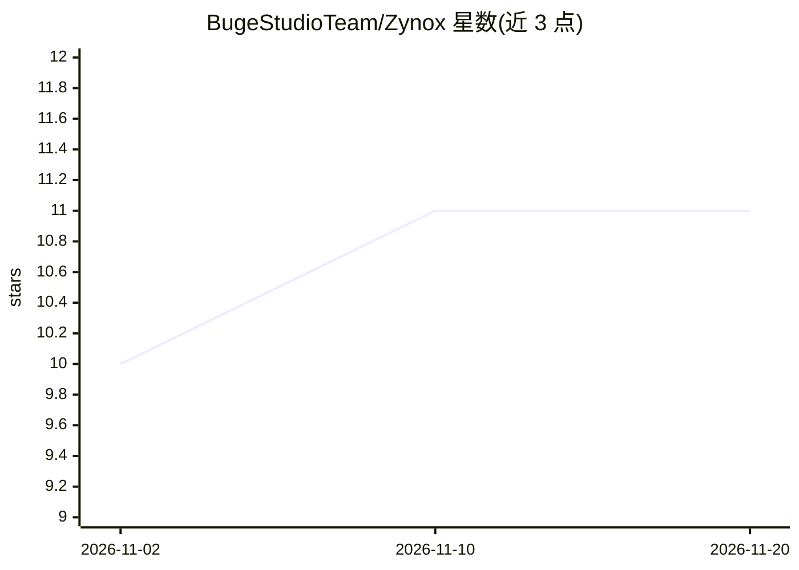

# BugeStudioTeam/Zynox

⭐ 11 · Python · MIT · 推送 2026-11-08 · [GitHub](https://github.com/BugeStudioTeam/Zynox) · [官网](https://bugestudio.website/zynox/) · 个人维护

**面向开发者的自然语言 CLI 助手：生成文件并执行命令**

ZynoxAI 是一个 Python 编写的跨平台命令行工具，用户用自然语言描述需求，工具调用云端大模型解析后自动创建文件/文件夹、生成代码内容并执行系统命令。支持在 OpenAI GPT、Gemini、Grok、DeepSeek 四家服务商间切换，提供会话记忆、API key 本地存储、缺包自动安装（支持 pkg/apt/yum/pacman/brew 五种包管理器）以及通过 Telegram 机器人远程控制。依赖 Python 3.7+ 与 requests，通过 git clone 脚本方式安装，另含 Web 界面（Flask，端口 5000）。

## 筛选速览

| 维度 | 判定 | 备注 |
|---|---|---|
| AI 角色 | `ai-native` | 本体是模型或模型工具 |
| 许可风险 | `permissive` | MIT |
| 部署形态 | `library` | 以包/库形式分发 |
| 模型依赖 | locked-api |  |
| 硬件要求 | — | 无带数字的原话,不猜 |
| 安装摩擦 | `low` | 无编译、无系统依赖或容器化 |
| 成熟度 | — | 结构信号不足 |

## 能力要点

- 自然语言创建文件/目录并生成代码内容
- 四家模型服务商可切换（OpenAI/Gemini/Grok/DeepSeek）
- 跨会话记忆系统，会话以 JSON 存于 ~/.zynoxai/memories/
- Telegram 机器人远程控制，带用户授权机制

## 适用场景

- 快速搭建项目脚手架和文件结构
- 在 Termux 上通过手机或 Telegram 远程操作开发环境
- 命令缺失时自动安装 zip/apktool 等工具

## 场景标签

`代码生成` `AI 助手` `聊天机器人` · 领域:编码与开发

## 证据(README 行号)

> L13: ZynoxAI is a command-line tool that leverages artificial intelligence to create files and folders based on natural 
> L33: - **Multi-AI Support** - Switch between OpenAI GPT, Google Gemini, Grok (xAI), and DeepSeek

## 星数曲线

2026-11-02 10 → 2026-11-20 11（+1）

---
*卡片 v1 · prompt 1.4 · 生成 2026-11-19 · 置信度 mid · 依据 README sha `9fc870630937` · [字段定义](../../DATASET.md)*
