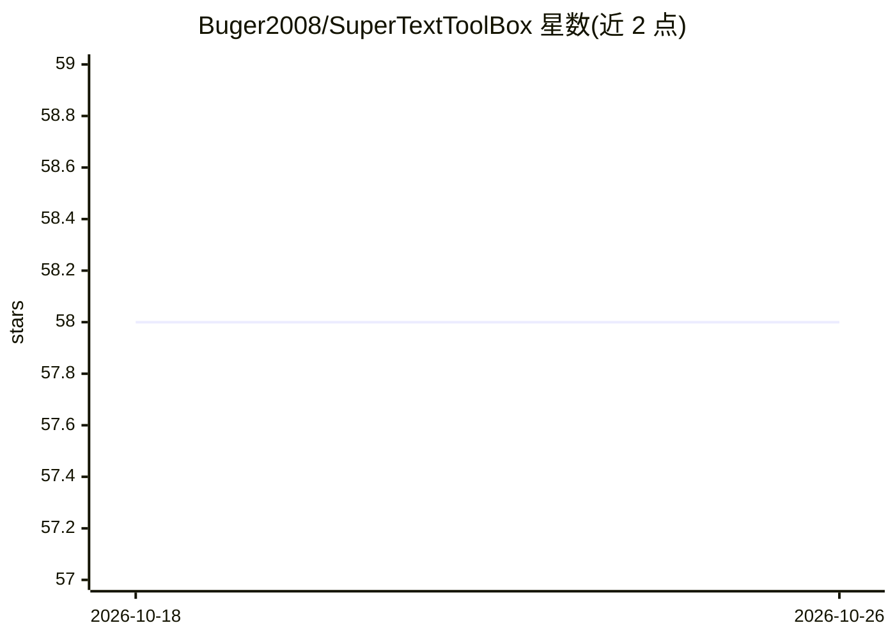

# Buger2008/SuperTextToolBox

⭐ 58 · C# · LGPL-3.0 · 推送 2026-07-29 · [GitHub](https://github.com/Buger2008/SuperTextToolBox) · 个人维护 · 中文 README

**Windows 免费文字处理工具箱：OCR、转语音、词云、翻译等**

面向 Windows 个人用户的免费桌面文字处理工具箱，基于多个开源库（PaddleOCRSharp、System.Speech、WordCloudSharp、Chinese 等）实现 OCR 识别（64 位、批量）、文字转语音、词云生成、文字转拼音、在线翻译（百度翻译 API，需自填 key）、分词、文字转图片等功能，除翻译外均可离线使用。另提供 Word 插件版本，附加批量打印、批量输出 PDF。要求 .NET Framework 4.7.2+，通过 winget 或安装包安装。README 含作者个人开发历程。

## 筛选速览

| 维度 | 判定 | 备注 |
|---|---|---|
| AI 角色 | `ai-native` | 本体是模型或模型工具 |
| 许可风险 | `viral` | LGPL-3.0 |
| 部署形态 | `None` |  |
| 模型依赖 | — | README 未给出锁定关系 |
| 硬件要求 | — | 无带数字的原话,不猜 |
| 安装摩擦 | `low` | 无编译、无系统依赖或容器化 |
| 成熟度 | — | 结构信号不足 |

## 能力要点

- 基于 PaddleOCRSharp 的批量 OCR 识别（64 位）
- 除翻译外全部功能可离线使用
- Word 插件版可在 Word 内使用全部功能并附加批量打印/输出 PDF
- 文字转长图片输出，可自定义每张图片字数

## 适用场景

- 离线批量识别图片中的文字
- 把文字转成语音、拼音或词云
- 在 Word 中直接调用这些文字处理功能并批量输出 PDF

## 场景标签

`OCR` `语音合成` · 领域:内容生成

## 证据(README 行号)

> L8: 本款软件基于Github上各种开源库制作而成（几乎没有什么代码研究价值），免费实现各种文字处理功能。包括OCR识别、文字转语音、词云生成、文字转拼音、翻译、分词等功能（除了翻译功能均可以离线使用）欢迎下载体验。
> L21: 基于PaddleOCRSharp开发，拥有很高的精确度（即使是位置杂乱无章的文本）。下图为示范图

## 星数曲线

2026-10-18 58 → 2026-10-26 58（+0）

---
*卡片 v1 · prompt 1.4 · 生成 2026-10-24 · 置信度 high · 依据 README sha `ce6d4df62860` · [字段定义](../../DATASET.md)*
