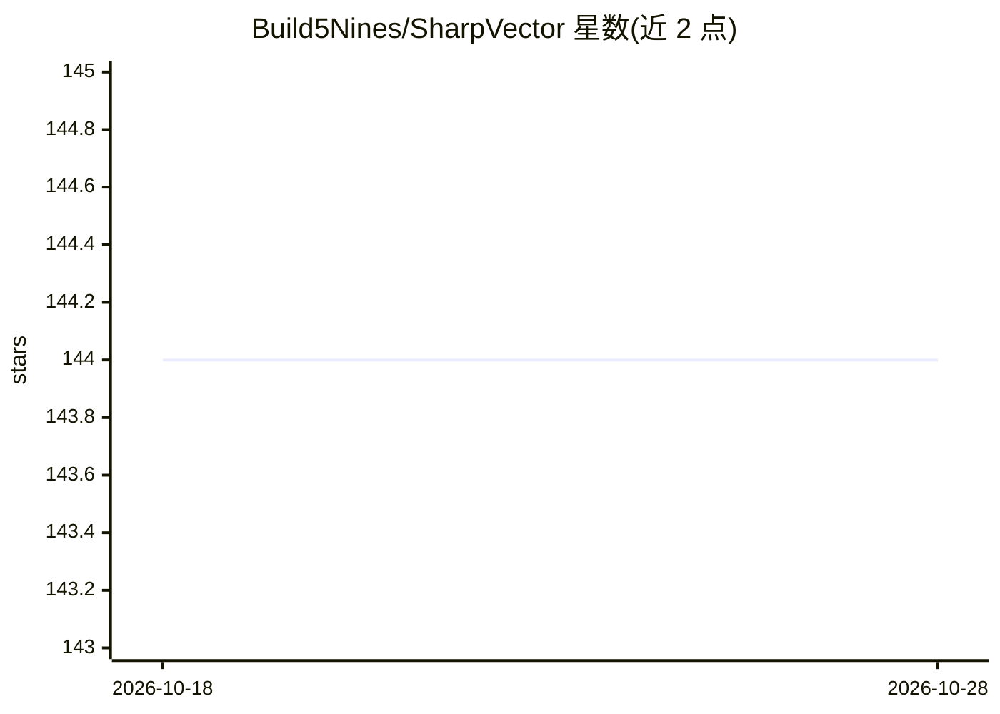

# Build5Nines/SharpVector

⭐ 144 · C# · MIT · 推送 2026-05-30 · [GitHub](https://github.com/Build5Nines/SharpVector) · [官网](https://sharpvector.build5nines.com/) · 个人维护

**面向 .NET 应用的轻量内存文本向量数据库库**

以 NuGet 包形式提供的 C#/.NET 内存向量数据库库，支持存储、检索与管理文本向量数据，用于实现语义搜索与 RAG 场景。提供可定制的向量比较方法、预处理技术与向量化策略，支持本地嵌入及 OpenAI、Ollama 嵌入。面向需要轻量级本地向量库（而非 CosmosDB、pgvector 等大型数据库）的 .NET 开发者。

## 筛选速览

| 维度 | 判定 | 备注 |
|---|---|---|
| AI 角色 | `ai-ecosystem` | LLM/agent 周边工具 |
| 许可风险 | `permissive` | MIT |
| 部署形态 | `None` |  |
| 模型依赖 | local-ok | 支持本地模型 |
| 硬件要求 | — | 无带数字的原话,不猜 |
| 安装摩擦 | `medium` | 含编译或系统依赖之一 |
| 成熟度 | — | 结构信号不足 |

## 能力要点

- 可嵌入任意 .NET 应用的内存文本向量数据库
- 支持自定义向量比较、预处理与向量化策略
- 支持本地嵌入、OpenAI 嵌入与 Ollama 嵌入
- MIT 许可，要求 .NET 8+

## 适用场景

- 在 .NET 应用中实现本地语义搜索
- 为 LLM 应用构建轻量级 RAG 检索层
- 无需外部大型数据库即可做文本向量检索

## 场景标签

`向量数据库` · 领域:知识与检索

## 证据(README 行号)

> L3: `Build5Nines.SharpVector` is an in-memory vector database library designed for .NET applications. It allows you to s
> L18: Vector databases are used with Semantic Search and Generative AI solutions augmenting the LLM (Large Language Model

## 星数曲线

2026-10-18 144 → 2026-10-28 144（+0）

---
*卡片 v1 · prompt 1.4 · 生成 2026-10-22 · 置信度 high · 依据 README sha `397dc5359bdb` · [字段定义](../../DATASET.md)*
