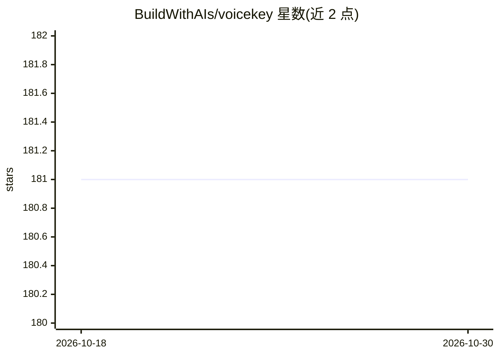

# BuildWithAIs/voicekey

⭐ 181 · TypeScript · MIT · 推送 2026-10-25 · [GitHub](https://github.com/BuildWithAIs/voicekey) · [官网](https://buildwithais.github.io/voicekey/) · 组织维护 · 中文 README

**本地优先的按键说话语音转文字桌面输入工具**

面向 Windows/macOS/Linux 用户的 Electron 桌面应用：按住热键录音、松开转写并注入到焦点应用的文本框。转写在本地完成，使用可下载的 ONNX 模型（SenseVoice 小模型或 X-ASR 双语流式模型），无需 ASR API key；可选接入用户自备 API key 的 LLM 提供商做转写清理与划词翻译，关闭后可完全离线。支持个人词典热词、本地历史与多语言界面。构建未签名，安装时可能触发系统警告；Wayland 下仅支持 Hyprland 集成路径。

## 筛选速览

| 维度 | 判定 | 备注 |
|---|---|---|
| AI 角色 | `ai-enhanced` | 去掉 AI 部分产品仍成立 |
| 许可风险 | `permissive` | MIT |
| 部署形态 | `desktop` | 安装包/桌面程序 |
| 模型依赖 | — | README 未给出锁定关系 |
| 硬件要求 | — | 无带数字的原话,不猜 |
| 安装摩擦 | `low` | 无编译、无系统依赖或容器化 |
| 成熟度 | `idea` | |

## 能力要点

- 本地 ONNX 转写（SenseVoice Small 约 240MB / X-ASR 流式约 586MB），无需 ASR API key
- 可选接入 OpenAI/Anthropic/DeepSeek/OpenRouter 或 OpenAI 兼容端点做清理与翻译
- 个人词典热词与本地历史记录（搜索/复制/删除）
- 全局热键、麦克风选择、状态 HUD、开机自启等桌面原生功能

## 适用场景

- 按住快捷键在任何应用里用语音输入文字
- 翻译选中文本并原地替换
- 不联网、不上传音频的本地语音转写工作流

## 场景标签

`语音识别` · 领域:感知与多模态

## 证据(README 行号)

> L9:  Hold a hotkey, speak, and release. Voice Key transcribes on your device, optionally cleans up
> L32: - **Local-first transcription** — raw audio is processed on your device with downloadable ONNX
> L37: - **Optional text cleanup** — connect OpenAI, Anthropic, DeepSeek, OpenRouter, or a custom OpenAI-compatible

## 星数曲线

2026-10-18 181 → 2026-10-30 181（+0）

---
*卡片 v1 · prompt 1.4 · 生成 2026-10-22 · 置信度 high · 依据 README sha `6d86c35ade3e` · [字段定义](../../DATASET.md)*
