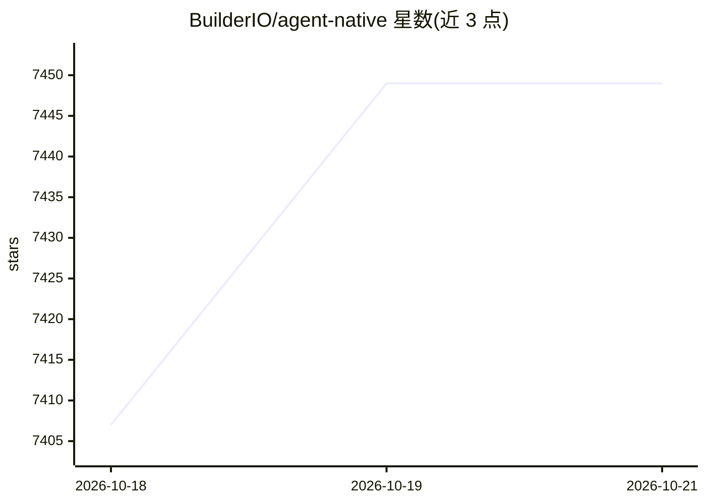

# BuilderIO/agent-native

⭐ 7,449 · TypeScript · MIT · 推送 2026-10-19 · [GitHub](https://github.com/BuilderIO/agent-native) · [官网](https://www.agent-native.com) · 组织维护

**TypeScript agent 应用框架：同一 action 供 agent 与 UI 共用**

开源 TypeScript 框架，用于构建带专属 UI 的 agentic 应用。核心机制是共享 action：每项能力定义一次，agent 作为工具调用，UI 从代码调用，走同一套验证、权限与实现；action 同时通过 HTTP、MCP、A2A 与 CLI 暴露。内置 agent 聊天、认证权限、技能与记忆、定时自动化、多 agent 协作，生产用 PostgreSQL、本地用 PGlite。LLM、数据库与基础设施由使用者自带。提供 npx 脚手架命令与多个示例 agent 应用。

## 筛选速览

| 维度 | 判定 | 备注 |
|---|---|---|
| AI 角色 | `ai-ecosystem` | LLM/agent 周边工具 |
| 许可风险 | `permissive` | MIT |
| 部署形态 | `library` | 以包/库形式分发 |
| 模型依赖 | — | README 未给出锁定关系 |
| 硬件要求 | — | 无带数字的原话,不猜 |
| 安装摩擦 | `low` | 无编译、无系统依赖或容器化 |
| 成熟度 | — | 结构信号不足 |

## 能力要点

- 共享 action 层：agent 工具调用与 UI 代码调用同一实现，含共享数据与应用状态
- action 经 HTTP、MCP、A2A 与 CLI 暴露
- 内置认证权限、技能记忆、自动化调度与 agent 团队协作
- 附 Clips/Design/Slides 等 11 个开源示例 agent 应用

## 适用场景

- 为知识型工作构建 agent 与 UI 共享同一能力层的应用
- 让 agent 在带可视化界面的环境中执行并让人审查、编辑其产出
- 基于示例应用（邮件、日历、分析等）二次开发自己的 agent 应用

## 场景标签

`Agent 框架` `多智能体` · 领域:Agent 开发

## 证据(README 行号)

> L16: Agent-Native is an open-source TypeScript framework for building agents that pair autonomous work with a purpose-bu
> L34: - **Shared actions.** The agent calls each capability as a tool, and the UI calls it from code. Both paths use the 

## 星数曲线

2026-10-18 7,407 → 2026-10-21 7,449（+42）

---
*卡片 v1 · prompt 1.4 · 生成 2026-10-20 · 置信度 high · 依据 README sha `b57f1b8122df` · [字段定义](../../DATASET.md)*
