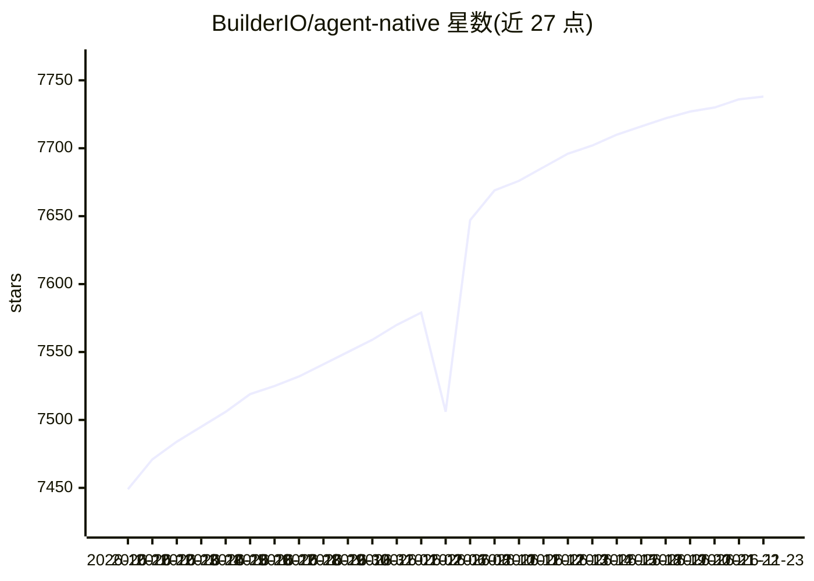

# BuilderIO/agent-native

⭐ 7,738 · TypeScript · MIT · 推送 2026-11-22 · [GitHub](https://github.com/BuilderIO/agent-native) · [官网](https://www.agent-native.com) · 组织维护

**构建带专用 UI 的 agent 应用的 TypeScript 框架**

开源 TypeScript 框架，用于构建将自主工作与专用 UI 结合的 agent 应用。核心机制是把每个能力定义一次为共享 action：agent 将其作为工具调用，UI 从代码调用同一实现，双方共用校验、权限与应用状态；并内置聊天、认证权限、技能记忆、定时自动化、多 agent 协作与 PostgreSQL/PGlite 后端。action 同时通过 HTTP、MCP、A2A 与 CLI 暴露。README 另附 9 个可直接使用的开源 agent 应用示例。

## 筛选速览

| 维度 | 判定 | 备注 |
|---|---|---|
| AI 角色 | `ai-ecosystem` | LLM/agent 周边工具 |
| 许可风险 | `permissive` | MIT |
| 部署形态 | `library` | 以包/库形式分发 |
| 模型依赖 | — | README 未给出锁定关系 |
| 硬件要求 | — | 无带数字的原话,不猜 |
| 安装摩擦 | `low` | 无编译、无系统依赖或容器化 |
| 成熟度 | — | 结构信号不足 |

## 能力要点

- 共享 action 层：agent 与 UI 调用同一实现、同一权限校验
- action 同时通过 HTTP、MCP、A2A 与 CLI 暴露
- 内置认证权限、技能记忆、自动化调度与 agent 团队协作
- 敏感结果可通过 persistInChatHistory 从持久化历史中脱敏

## 适用场景

- 搭建 agent 与用户在同一界面协作的知识工作应用
- 为团队构建带权限控制的 agent 工作台
- 让 agent 产出直接出现在业务 UI 中供人审阅编辑

## 场景标签

`Agent 框架` `多智能体` · 领域:Agent 开发

## 证据(README 行号)

> L16: Agent-Native is an open-source TypeScript framework for building agents that pair autonomous work with a purpose-bu
> L34: - **Shared actions.** The agent calls each capability as a tool, and the UI calls it from code. Both paths use the 
> L51: The agent receives `hello` as a tool. React calls the same function with `useActionQuery("hello", { name: "Alex" })

## 星数曲线

2026-10-21 7,449 → 2026-11-23 7,738（+289）

---
*卡片 v1 · prompt 1.4 · 生成 2026-11-22 · 置信度 high · 依据 README sha `0eadba0d1154` · [字段定义](../../DATASET.md)*
