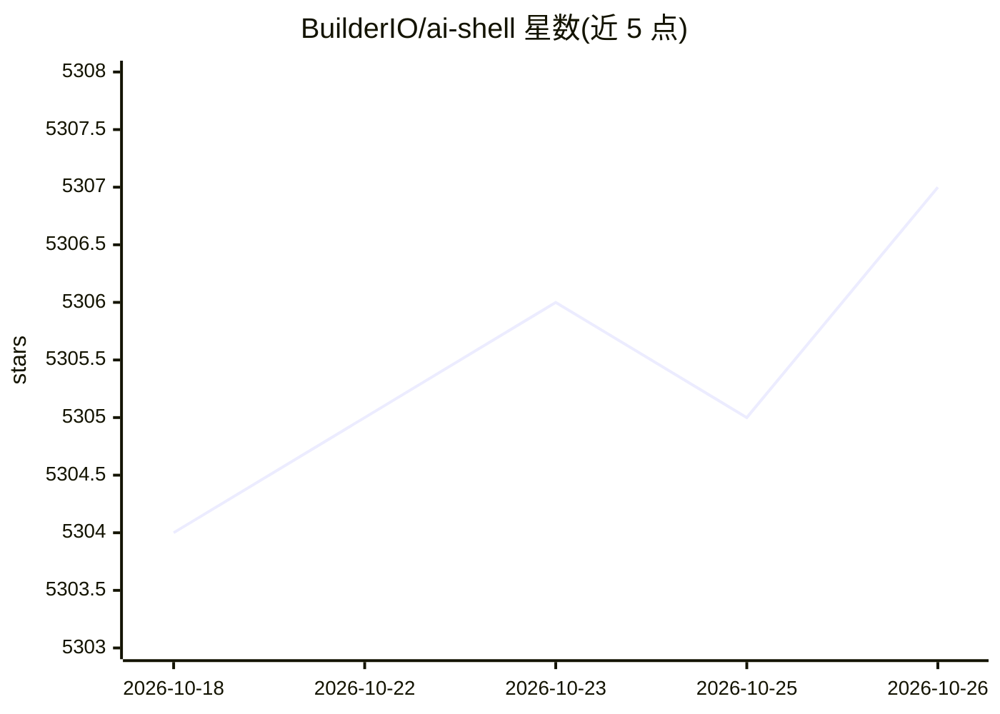

# BuilderIO/ai-shell

⭐ 5,307 · TypeScript · MIT · 推送 2026-01-05 · [GitHub](https://github.com/BuilderIO/ai-shell) · 组织维护 · 中文 README

**自然语言转 shell 命令的开源 CLI 工具**

由 Builder.io 维护的命令行工具：输入自然语言提示（如 list all log files），调用 OpenAI API 生成对应 shell 命令，用户可选择运行、修改或取消。支持聊天模式（ai chat）、静默模式（-s 跳过解释）、自定义 OpenAI API 端点、交互式配置界面，UI 支持 14 种语言切换。安装方式为 npm 全局安装，需配置 OpenAI API key（需账户与计费设置）。README 提及灵感来自 GitHub Copilot X CLI。

## 筛选速览

| 维度 | 判定 | 备注 |
|---|---|---|
| AI 角色 | `ai-native` | 本体是模型或模型工具 |
| 许可风险 | `permissive` | MIT |
| 部署形态 | `library` | 以包/库形式分发 |
| 模型依赖 | — | README 未给出锁定关系 |
| 硬件要求 | — | 无带数字的原话,不猜 |
| 安装摩擦 | `low` | 无编译、无系统依赖或容器化 |
| 成熟度 | — | 结构信号不足 |

## 能力要点

- 自然语言输入生成 shell 命令，可选择运行/修改/取消
- 聊天模式支持 CLI 内对话
- 可自定义 OpenAI API 端点（OPENAI_API_ENDPOINT）
- UI 支持 14 种语言，含简体/繁体中文

## 适用场景

- 不熟悉 shell 语法时用自然语言生成命令
- 在终端内直接向 AI 提问并获取回答（chat 模式）
- 通过自定义端点接入代理或兼容 API

## 场景标签

`AI 助手` `代码生成` · 领域:编码与开发

## 证据(README 行号)

> L3:  A CLI that converts natural language to shell commands.
> L44: ai list all log files
> L69: ai chat

## 星数曲线

2026-10-18 5,304 → 2026-10-26 5,307（+3）

---
*卡片 v1 · prompt 1.4 · 生成 2026-10-20 · 置信度 high · 依据 README sha `315f3b9ea0b0` · [字段定义](../../DATASET.md)*
