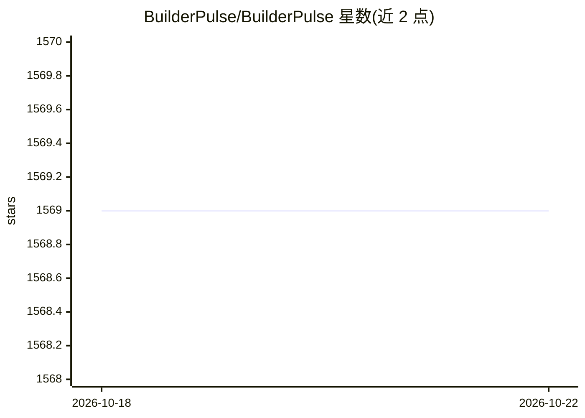

# BuilderPulse/BuilderPulse

⭐ 1,568 · NOASSERTION · 推送 2026-08-14 · [GitHub](https://github.com/BuilderPulse/BuilderPulse) · [官网](https://builderpulse.ai) · 组织维护 · 中文 README

**面向独立开发者的每日构建机会简报：AI 聚合 300+ 信号产出选题**

面向 indie hackers 与 MicroSaaS 创始人的每日机会简报仓库：每天交叉验证来自 Hacker News、GitHub Trending、Product Hunt、HuggingFace、Google Trends、Reddit 等 300+ 公开信号，产出一个具体可做的构建方向及其"为什么是现在"的理由，并附溯源链接。README 展示当日建议与 7 天信号记录，提供中英双语版本与 RSS 订阅。内容以 CC BY-NC 4.0 非商业许可发布，不提供安装或代码运行方式。

## 筛选速览

| 维度 | 判定 | 备注 |
|---|---|---|
| AI 角色 | `ai-knowledge` | 知识聚合/清单类 |
| 许可风险 | `none` | NOASSERTION |
| 部署形态 | `None` |  |
| 模型依赖 | — | README 未给出锁定关系 |
| 硬件要求 | — | 无带数字的原话,不猜 |
| 安装摩擦 | `low` | 无编译、无系统依赖或容器化 |
| 成熟度 | — | 结构信号不足 |

## 能力要点

- 每日从 300+ 公开信号交叉验证并产出一个构建建议
- 覆盖 Hacker News、GitHub Trending、Product Hunt、Reddit 等 10+ 来源
- 提供中英双语内容与 7 天信号追踪记录

## 适用场景

- 独立开发者每天获取一个有据可查的产品构建方向
- MicroSaaS 创始人跟踪近期社区热点信号寻找选题
- 通过 RSS 订阅每日机会简报

## 场景标签

`精选清单` · 领域:学习与行业

## 证据(README 行号)

> L52: **Who this is for:** indie hackers and MicroSaaS founders who want one high-conviction build direction per day, not
> L54: **How it works:** every day we cross-validate 300+ live public signals across Hacker News, GitHub Trending, Product

## 星数曲线

2026-10-18 1,569 → 2026-10-22 1,569（+0）

---
*卡片 v1 · prompt 1.4 · 生成 2026-10-21 · 置信度 high · 依据 README sha `664679f10936` · [字段定义](../../DATASET.md)*
