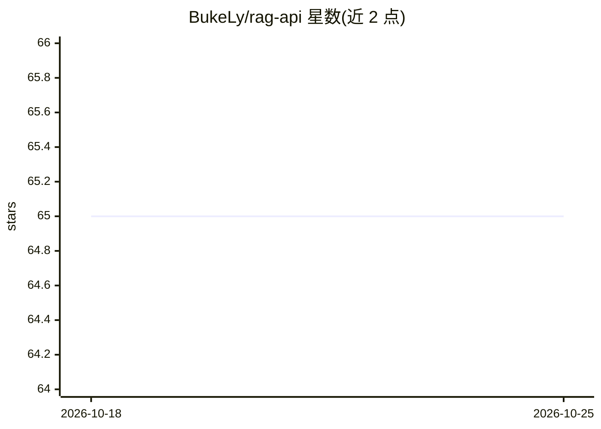

# BukeLy/rag-api

⭐ 66 · Python · 推送 2025-12-15 · [GitHub](https://github.com/BukeLy/rag-api) · 个人维护 · 中文 README

**多租户多模态文档 RAG 服务，自动选择文档解析引擎**

基于 FastAPI 构建的企业级 RAG 服务，组合 RAG-Anything 的文档解析与 LightRAG 的知识图谱混合检索，面向需要文档问答 API 的开发与企业场景。支持 PDF/Word/Excel/图片等格式，解析引擎可选 DeepSeek-OCR（远程）、MinerU（本地/远程）与 Docling；提供租户级数据隔离、每租户独立 LLM/Embedding/Rerank 配置、批量上传任务队列与 Redis 任务持久化。以 Docker Compose 一键部署为主，也可用 uv 本地开发；查询支持 naive/local/global/hybrid/mix 五种模式与流式输出。

## 筛选速览

| 维度 | 判定 | 备注 |
|---|---|---|
| AI 角色 | `ai-ecosystem` | LLM/agent 周边工具 |
| 许可风险 | `none` | — |
| 部署形态 | `self-host` | docker 或自建部署 |
| 模型依赖 | — | README 未给出锁定关系 |
| 硬件要求 | — | 无带数字的原话,不猜 |
| 安装摩擦 | `low` | 无编译、无系统依赖或容器化 |
| 成熟度 | — | 结构信号不足 |

## 能力要点

- 多租户隔离：独立 LightRAG 实例、向量索引与知识图谱，支持每租户独立配置 5 类服务并热重载
- 三种解析引擎（DeepSeek-OCR/MinerU/Docling）与 RAG-Anything VLM 三档图表理解模式
- 五种查询模式（naive/local/global/hybrid/mix）与多轮对话、流式输出
- 批量上传（单批最多 100 文件）、异步任务队列与任务持久化恢复

## 适用场景

- 企业内部多租户文档问答服务，各租户用自己的 LLM API key
- 批量解析含图表的研究报告/论文并做知识图谱检索问答
- 为自有应用接入一个自托管的 RAG REST API

## 场景标签

`RAG` `文档解析` · 领域:知识与检索

## 证据(README 行号)

> L20: RAG API is an enterprise-grade Retrieval-Augmented Generation (RAG) service that combines the powerful document par
> L24: - 🏢 **Multi-tenant Isolation** - Complete tenant data isolation for enterprise multi-tenant scenarios

## 星数曲线

2026-10-18 65 → 2026-10-25 65（+0）

---
*卡片 v1 · prompt 1.4 · 生成 2026-10-24 · 置信度 high · 依据 README sha `1e1ca73e9cec` · [字段定义](../../DATASET.md)*
