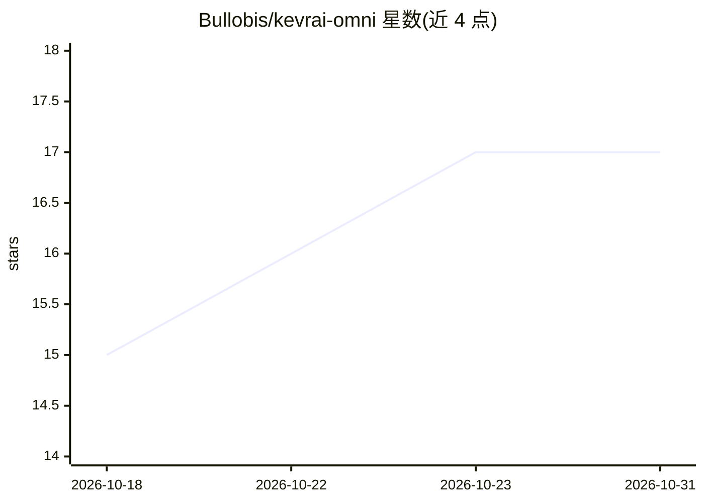

# Bullobis/kevrai-omni

⭐ 17 · Python · NOASSERTION · 推送 2026-10-30 · [GitHub](https://github.com/Bullobis/kevrai-omni) · 个人维护 · 中文 README

**面向本地用户的桌面 AI 工作站，集成模型市场与多模态生成**

Electron + 原生 JS 前端搭配本地 FastAPI Python sidecar 的桌面应用，数据默认落在本机。提供模型市场（搜索/筛选/收藏/断点下载）、本地 GGUF/safetensors 导入、llama.cpp 与 MNN 双引擎管理与推理、硬件检测（NVIDIA/AMD ROCm/华为昇腾/CPU）与模型量化推荐；功能覆盖 LLM 对话、TTS、图像、视频（内置 LTX-2.5 文生视频/图生视频）、3D、超分与 ReAct Agent 助手，技能可从目录/zip/git 导入。发行包无需预装 Python，首次启动自动引导便携运行时；也可从源码运行（Node.js 22+ / Python 3.11+）。

## 筛选速览

| 维度 | 判定 | 备注 |
|---|---|---|
| AI 角色 | `ai-native` | 本体是模型或模型工具 |
| 许可风险 | `none` | NOASSERTION |
| 部署形态 | `library` | 以包/库形式分发 |
| 模型依赖 | local-ok | 支持本地模型 |
| 硬件要求 | — | 无带数字的原话,不猜 |
| 安装摩擦 | `low` | 无编译、无系统依赖或容器化 |
| 成熟度 | — | 结构信号不足 |

## 能力要点

- llama.cpp + MNN 双引擎按需安装、加载与对话
- 自动探测 CPU/GPU/NPU 并推荐模型与量化档
- 内置 LTX-2.5 文生视频/图生视频，参数可调，输出 MP4/GIF
- ReAct Agent 助手，技能支持本地目录/zip/git 导入

## 适用场景

- 在本机一站式下载、管理并运行 LLM/TTS/图像/视频模型
- 根据自家显卡配置获得模型与量化档推荐
- 离线使用已下载模型进行对话、生成视频与运行 Agent 技能

## 场景标签

`图像生成` `语音合成` `视频生成` `推理引擎` · 领域:内容生成

## 证据(README 行号)

> L3: > 一键本地 AI 工作站：LLM / TTS / 图像 / 视频 / 3D / 音频 / 超分辨率，llama.cpp + MNN 双引擎，硬件感知推荐，内置 LTX-2.5 视频生成、Agent 助手与超级搜索。
> L5: Kevrai Omni 是一个 **Electron + 原生 HTML/CSS/JS** 的桌面应用，搭配一个本地 Python（FastAPI）sidecar 负责模型目录、下载、引擎与推理。所有数据默认落在本机，不依赖远程服务

## 星数曲线

2026-10-18 15 → 2026-10-31 17（+2）

---
*卡片 v1 · prompt 1.4 · 生成 2026-10-30 · 置信度 high · 依据 README sha `e43b475a8fbf` · [字段定义](../../DATASET.md)*
