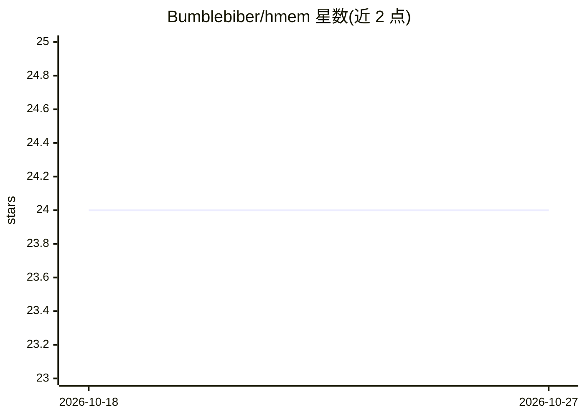

# Bumblebiber/hmem

⭐ 24 · TypeScript · MIT · 推送 2026-07-21 · [GitHub](https://github.com/Bumblebiber/hmem) · [官网](https://ko-fi.com/bumblebiber) · 个人维护

**面向 AI agent 的跨会话持久记忆框架（MCP 服务 + SDK）**

hmem 是为 Claude Code 等 AI 编码工具提供的持久记忆基础设施：以 SQLite 存储分层 5 级懒加载的记忆树，一次 load_project 调用约 3000 tokens 获得项目简报；自动记录会话交换（Stop hook），每 N 次交换由 Haiku/DeepSeek 后台子代理生成检查点与交接笔记；支持跨设备同步（hmem-sync）与共享公司记忆库。提供 2 个 MCP 服务器（13+11 工具）、21 个默认技能与 TypeScript SDK，通过 npm 全局安装，兼容 Claude Code、Gemini CLI、Cursor 等多客户端。限制：同步需另装 hmem-sync；curate 工具具破坏性需手动启用。

## 筛选速览

| 维度 | 判定 | 备注 |
|---|---|---|
| AI 角色 | `ai-ecosystem` | LLM/agent 周边工具 |
| 许可风险 | `permissive` | MIT |
| 部署形态 | `library` | 以包/库形式分发 |
| 模型依赖 | — | README 未给出锁定关系 |
| 硬件要求 | — | 无带数字的原话,不猜 |
| 安装摩擦 | `low` | 无编译、无系统依赖或容器化 |
| 成熟度 | — | 结构信号不足 |

## 能力要点

- 5 级懒加载记忆树：300+ 条目概览约 5k tokens，完整原文按需下钻
- 自动会话捕获 + Haiku/DeepSeek 后台检查点，生成跨 provider 交接笔记
- 双 MCP 服务器共 24 个工具（日常读写 + 维护迁移）
- 个人与公司共享记忆库并存，TypeScript SDK 可嵌入自有 agent

## 适用场景

- 让 Claude Code 等编码 agent 跨会话、跨设备、跨工具记住项目上下文
- 团队多 agent 共享公司级记忆库
- 减少每次会话重复加载代码库的 token 开销

## 场景标签

`Agent 记忆` · 领域:Agent 开发

## 证据(README 行号)

> L15: hmem is not a note-taking plugin. It's a **memory framework** for AI agents — a complete infrastructure layer for p
> L144: - **`hmem`** (daily-use, 13 tools) — read, write, search, project lifecycle.

## 星数曲线

2026-10-18 24 → 2026-10-27 24（+0）

---
*卡片 v1 · prompt 1.4 · 生成 2026-10-27 · 置信度 high · 依据 README sha `55e824a229a4` · [字段定义](../../DATASET.md)*
