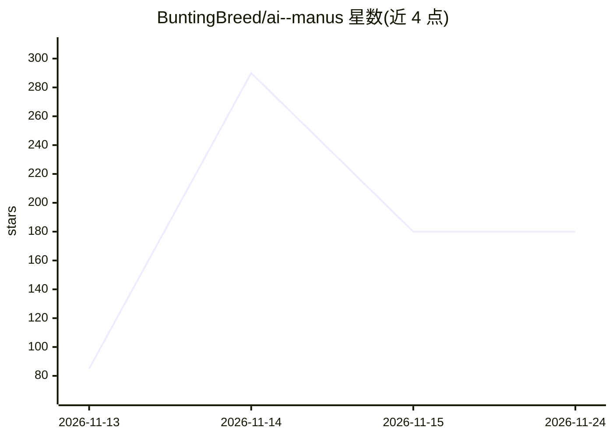

# BuntingBreed/ai--manus

⭐ 180 · Apache-2.0 · 推送 2026-11-15 · [GitHub](https://github.com/BuntingBreed/ai--manus) · 个人维护

**面向个人用户的自主 AI Agent：代跑代码与操作浏览器**

Manus 是一个自主 AI Agent 系统，在沙箱环境中运行各类工具与操作：自主编写并执行代码、控制浏览器（导航网页、填表、采集信息）、执行多步骤任务，并可在后台作为个人助手处理学习、家庭与轻量办公中的重复性工作。README 面向非开发者用户，描述了配置流程与适用场景，并给出系统兼容性表（最低 4GB 内存、双核 CPU）。描述提到有下载入口（Download Manus / PROMO2026），但 README 未提供源码安装、依赖或技术架构细节。

## 筛选速览

| 维度 | 判定 | 备注 |
|---|---|---|
| AI 角色 | `ai-native` | 本体是模型或模型工具 |
| 许可风险 | `permissive` | Apache-2.0 |
| 部署形态 | `None` |  |
| 模型依赖 | — | README 未给出锁定关系 |
| 硬件要求 | — | 无带数字的原话,不猜 |
| 安装摩擦 | `low` | 无编译、无系统依赖或容器化 |
| 成熟度 | — | 结构信号不足 |

## 能力要点

- 自主编写并执行代码完成任务
- 浏览器控制：导航网页、填表、采集信息
- 代码与浏览器动作可在同一工作流中衔接
- 沙箱环境中运行工具与操作

## 适用场景

- 让学生整理研究笔记、跑小脚本
- 远程工作者从多个网页汇总采集信息
- 把重复性的小任务委托给后台 agent 执行

## 场景标签

`AI 助手` `浏览器自动化` `编码 Agent` · 领域:效率与自动化

## 证据(README 行号)

> L10: - **Autonomous Code Execution:** Manus AI agent runs code on its own to complete tasks, so you can focus on decisio
> L18: Manus is an autonomous AI agent designed to run code and control a browser on your behalf. Instead of acting like a

## 星数曲线

2026-11-13 85 → 2026-11-24 180（+95）

---
*卡片 v1 · prompt 1.4 · 生成 2026-11-17 · 置信度 low · 依据 README sha `0f78ee3a5dd2` · [字段定义](../../DATASET.md)*
