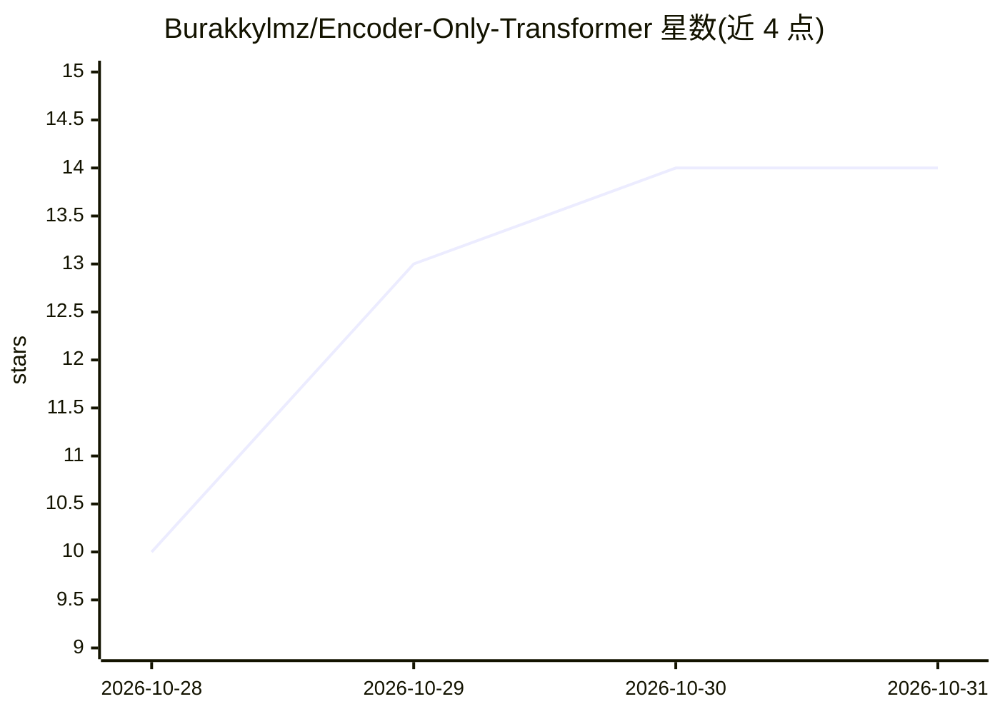

# Burakkylmz/Encoder-Only-Transformer

⭐ 14 · Python · 推送 2026-05-10 · [GitHub](https://github.com/Burakkylmz/Encoder-Only-Transformer) · 个人维护

**从零构建的 Encoder-only Transformer 教学实现，含训练与测试**

教育导向的 PyTorch 项目：逐组件从零实现 Encoder-only Transformer（Token Embedding、位置编码、自注意力、多头注意力、前馈网络、Encoder Block、堆叠编码器、池化、序列分类头），用 Factory Pattern 做 config 驱动的模型构建，提供 trainer、metrics、单元测试与可运行实验脚本（支持 seed、checkpoint 保存/恢复）。范围刻意排除 decoder 生成、大规模预训练、完整 BERT 复现与生产部署。面向学习者、开发者与教学者，要求 Python 3.10 与 uv 管理环境。

## 筛选速览

| 维度 | 判定 | 备注 |
|---|---|---|
| AI 角色 | `ai-native` | 本体是模型或模型工具 |
| 许可风险 | `none` | — |
| 部署形态 | `None` |  |
| 模型依赖 | — | README 未给出锁定关系 |
| 硬件要求 | — | 无带数字的原话,不猜 |
| 安装摩擦 | `low` | 无编译、无系统依赖或容器化 |
| 成熟度 | — | 结构信号不足 |

## 能力要点

- 逐组件从零实现 Encoder-only Transformer 全流程
- config/default.yaml 驱动模型与训练参数
- 单元测试覆盖各主要模块，uv 管理环境
- 实验脚本支持确定性 seed 与 checkpoint 保存/恢复

## 适用场景

- 通过读代码与跑测试理解 Transformer 内部机制
- 课程教学中用作 encoder 架构的参考实现
- 在使用现成库之前先理解 encoder 内部结构

## 场景标签

`教程课程` · 领域:学习与行业

## 证据(README 行号)

> L3: This is an educational project that aims to build the **Encoder-only Transformer** architecture **from scratch** and
> L27: * Why is **Pooling** needed?

## 星数曲线

2026-10-28 10 → 2026-10-31 14（+4）

---
*卡片 v1 · prompt 1.4 · 生成 2026-10-31 · 置信度 high · 依据 README sha `99f72fc7f34f` · [字段定义](../../DATASET.md)*
