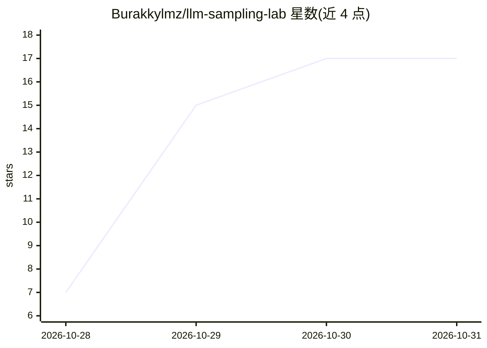

# Burakkylmz/llm-sampling-lab

⭐ 17 · Python · 推送 2026-10-20 · [GitHub](https://github.com/Burakkylmz/llm-sampling-lab) · 个人维护

**面向学习者的 LLM 采样策略实验环境：用模拟与真实 API 理解 Temperature/Top-k/Top-p**

Python 教学项目，通过三条路径讲解 LLM 采样：用 Groq Chat Completions API 做 Temperature 与 Top-p 真实生成实验；在预定义 token 概率分布上离线模拟三种采样策略并用 Matplotlib 生成 PNG 图表；结合本地采样与 Groq 生成土耳其语影评。实验以随机种子保证可复现，结果按 JSON 增量持久化并计算唯一响应比（URR）。推荐 Docker Compose 运行（无需本地装 Python），真实实验需 Groq API key，离线模拟则不需要。文档明确说明 Groq 不暴露 Top-k 参数，本地 Top-k 只作用于影评风格分布而非模型内部采样。

## 筛选速览

| 维度 | 判定 | 备注 |
|---|---|---|
| AI 角色 | `ai-knowledge` | 知识聚合/清单类 |
| 许可风险 | `none` | — |
| 部署形态 | `self-host` | docker 或自建部署 |
| 模型依赖 | locked-api |  |
| 硬件要求 | — | 无带数字的原话,不猜 |
| 安装摩擦 | `low` | 无编译、无系统依赖或容器化 |
| 成熟度 | — | 结构信号不足 |

## 能力要点

- Temperature/Top-k/Top-p 的离线模拟与可视化（PNG 图表）
- 基于 Groq API 的真实生成实验，含唯一响应比（URR）计算
- 本地采样 + Groq 生成结合的影评实验，随机种子保证可复现
- Docker Compose 运行，无需本地安装 Python 依赖；离线模拟无需 API key

## 适用场景

- 我想直观理解 Temperature、Top-k、Top-p 对生成多样性的影响
- 教学中演示采样参数效果并比较理论与观测频率
- 做可复现的 LLM 采样对比实验并留存 JSON 报告

## 场景标签

`教程课程` · 领域:学习与行业

## 证据(README 行号)

> L3: **A hands-on laboratory for understanding LLM sampling strategies through real API experiments and offline simulatio
> L17: ## 1. Learning Objectives
> L19: After completing this laboratory, participants should be able to:

## 星数曲线

2026-10-28 7 → 2026-10-31 17（+10）

---
*卡片 v1 · prompt 1.4 · 生成 2026-10-30 · 置信度 high · 依据 README sha `4bbb0aaba32f` · [字段定义](../../DATASET.md)*
