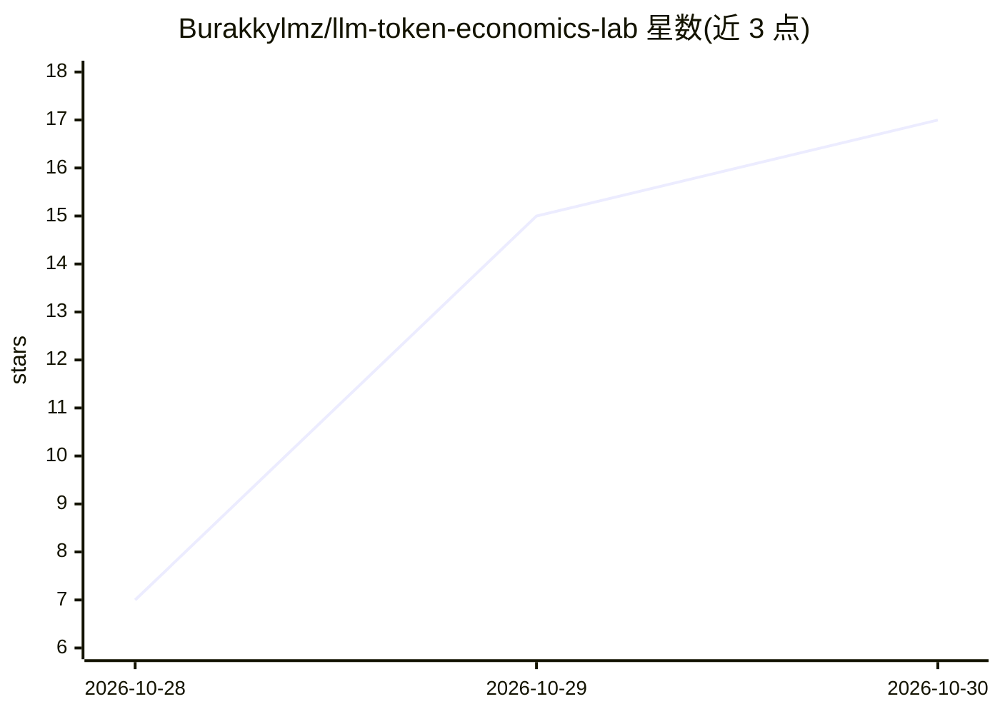

# Burakkylmz/llm-token-economics-lab

⭐ 17 · Python · 推送 2026-10-29 · [GitHub](https://github.com/Burakkylmz/llm-token-economics-lab) · 个人维护

**面向学习者的 LLM 工程实验集：token 成本与 API 性能实测**

包含 10 个可复现 Python 实验（labs）的动手训练项目，使用真实 Groq API 请求探索 token 经济学、API 成本计算、缓存、上下文增长、延迟、模型路由、限流、并发与批处理。全部实验逻辑由离线单元测试覆盖（mocked Groq 客户端，无需 API key 或网络）；真实 API 调用仅在显式传 `--live` 且配置 `live_api_enabled = true` 时发生。提供 Docker Compose 与 uv 两种运行路径，另含面向参与者和讲师的文档。

## 筛选速览

| 维度 | 判定 | 备注 |
|---|---|---|
| AI 角色 | `ai-knowledge` | 知识聚合/清单类 |
| 许可风险 | `none` | — |
| 部署形态 | `self-host` | docker 或自建部署 |
| 模型依赖 | locked-api |  |
| 硬件要求 | — | 无带数字的原话,不猜 |
| 安装摩擦 | `low` | 无编译、无系统依赖或容器化 |
| 成熟度 | — | 结构信号不足 |

## 能力要点

- 10 个实验覆盖成本、缓存、延迟、路由、限流、并发、批处理
- 默认离线：单元测试使用 mocked Groq 客户端，无需 API key
- 真实 API 调用需显式 `--live` 标志加配置双重确认
- Docker Compose 与 uv 两种运行路径，附讲师文档与预捕获批处理样例

## 适用场景

- 学习 LLM API 的成本构成与性能权衡
- 在可控离线环境中练习 API 工程（限流、并发、批处理）
- 培训场景下作为课程实验材料使用

## 场景标签

`教程课程` · 领域:学习与行业

## 证据(README 行号)

> L3: A hands-on training project covering token economics, API cost calculation,
> L9: **All 10 labs implemented, on top of the shared Stage 0 foundation.**
> L10: Every lab's logic is covered by fully offline unit tests (mocked Groq

## 星数曲线

2026-10-28 7 → 2026-10-30 17（+10）

---
*卡片 v1 · prompt 1.4 · 生成 2026-10-30 · 置信度 mid · 依据 README sha `c777f256dc41` · [字段定义](../../DATASET.md)*
