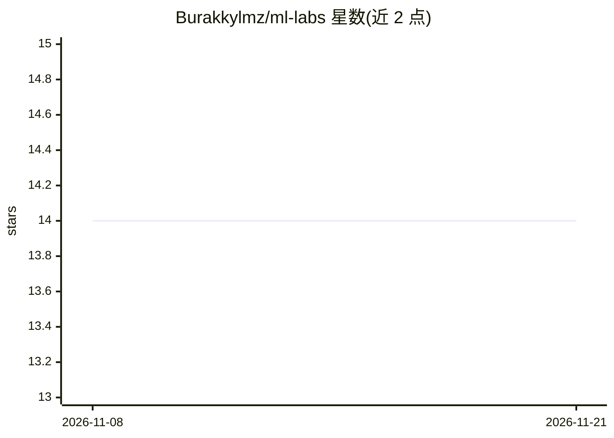

# Burakkylmz/ml-labs

⭐ 14 · Jupyter Notebook · 推送 2026-11-18 · [GitHub](https://github.com/Burakkylmz/ml-labs) · 个人维护

**基于 Docker 的机器学习动手实验环境与教程实验集**

一个 Docker 化、可复现的 Python 实验环境，为动手机器学习培训提供统一工作区：内置 JupyterLab 与 NumPy、Pandas、scikit-learn、Matplotlib 数据科学栈，保证实验笔记本在所有参与者机器上一致运行。依赖由 uv 在 pyproject.toml/uv.lock 中锁定管理，容器通过 Docker Compose 启动，labs/、data/、src/ 目录以 bind-mount 保留在宿主机。深度学习框架与 GPU 支持明确不在本项目范围内。

## 筛选速览

| 维度 | 判定 | 备注 |
|---|---|---|
| AI 角色 | `ai-knowledge` | 知识聚合/清单类 |
| 许可风险 | `none` | — |
| 部署形态 | `self-host` | docker 或自建部署 |
| 模型依赖 | — | README 未给出锁定关系 |
| 硬件要求 | — | 无带数字的原话,不猜 |
| 安装摩擦 | `low` | 无编译、无系统依赖或容器化 |
| 成熟度 | — | 结构信号不足 |

## 能力要点

- Docker Compose 一键构建并启动 JupyterLab 实验环境
- uv + uv.lock 锁定依赖，实验跨机器可复现
- 实验覆盖数据分析、统计、EDA、预处理、模型训练、评估与预测
- 本地文件 bind-mount 挂载，容器重建后工作成果保留

## 适用场景

- 参加或组织机器学习动手培训，统一所有人的实验环境
- 按步骤完成数据分析、预处理到模型评估的实验
- 在隔离容器中运行 JupyterLab 而不污染本地环境

## 场景标签

`教程课程` · 领域:学习与行业

## 证据(README 行号)

> L5: `ml-labs` is a Docker-based, reproducible Python lab environment for a hands-on Machine
> L9: support are intentionally out of scope and will live in a separate project.

## 星数曲线

2026-11-08 14 → 2026-11-21 14（+0）

---
*卡片 v1 · prompt 1.4 · 生成 2026-11-18 · 置信度 mid · 依据 README sha `78b1c180e4ce` · [字段定义](../../DATASET.md)*
