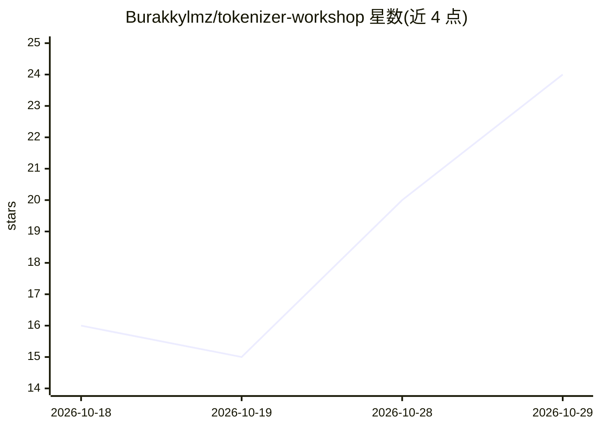

# Burakkylmz/tokenizer-workshop

⭐ 24 · Python · 推送 2026-10-27 · [GitHub](https://github.com/Burakkylmz/tokenizer-workshop) · 个人维护

**教学型 Python 项目：从零实现字符/字节/BPE 分词器学习分词原理**

面向学习 AI/NLP 的开发者、工程师与教学者的分词教学项目：以渐进对比方式从零实现 CharTokenizer、ByteTokenizer 与 SimpleBPETokenizer，并配套 token 数、词表大小等简单指标与测试驱动流程。提供 CLI 入口，另含 Docker Compose 工作流（Web UI、CLI、离线测试三种服务），Web 端支持 Markdown/PDF 报告导出。明确声明不追求生产级性能、不解决大规模数据与优化问题，项目状态标注为 in progress。

## 筛选速览

| 维度 | 判定 | 备注 |
|---|---|---|
| AI 角色 | `ai-ecosystem` | LLM/agent 周边工具 |
| 许可风险 | `none` | — |
| 部署形态 | `self-host` | docker 或自建部署 |
| 模型依赖 | — | README 未给出锁定关系 |
| 硬件要求 | — | 无带数字的原话,不猜 |
| 安装摩擦 | `low` | 无编译、无系统依赖或容器化 |
| 成熟度 | — | 结构信号不足 |

## 能力要点

- 从零实现字符级、字节级、BPE 三种分词器并对比学习
- Docker 单镜像提供 Web UI、CLI 与离线测试三种工作流
- 简单评估指标：token 数、词表大小、跨分词器比较
- 测试驱动开发流程，离线测试无需网络与 API 凭证

## 适用场景

- 通过写代码理解字符级、字节级与子词分词的差异
- 在培训或自学中演示为何同一文本在不同分词器下 token 数不同
- 本地或 Docker 环境中运行分词比较并生成报告

## 场景标签

`教程课程` · 领域:学习与行业

## 证据(README 行号)

> L5: `tokenizer-workshop` is a Python project developed to teach the concept of tokenization in a practical and education
> L17: Tokenization is one of the most fundamental layers of NLP and LLM systems; however, in most trainings it is either 
> L45: * `CharTokenizer`

## 星数曲线

2026-10-18 16 → 2026-10-29 24（+8）

---
*卡片 v1 · prompt 1.4 · 生成 2026-10-28 · 置信度 mid · 依据 README sha `54cae2011151` · [字段定义](../../DATASET.md)*
