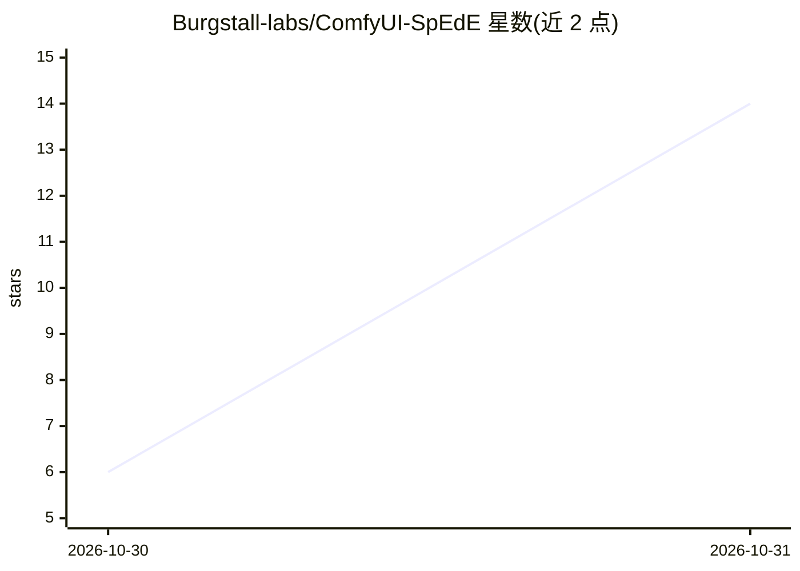

# Burgstall-labs/ComfyUI-SpEdE

⭐ 14 · Python · AGPL-3.0 · 推送 2026-10-29 · [GitHub](https://github.com/Burgstall-labs/ComfyUI-SpEdE) · 组织维护

**高斯泼溅场景物体编辑引擎：点击后移除/替换/提取 3D 对象**

ComfyUI 节点包加本地 Web Studio：在 3D 高斯泼溅（3DGS）场景中点击选中物体，通过 SAM 3.1 多相机分割、视觉 hull 收集并删除对应高斯点，用 Qwen-Image 2.1 补绘被遮挡表面、MoGe-3 估计深度并仅在有洞处生成新高斯点；也可将物体导出为仅含物体的 PLY，或用 Qwen-Image 生成新物体经 TripoSplat 转 3D 后放回原位。提供 33 个节点、10 个工作流模板与 FastAPI 网页界面，全程本地 GPU 运行、无云端调用。限制：仅补绘支撑表面，非通用 3D 修补；权重需自行下载；仅在单卡 RTX 5090 / Ubuntu 24.04 环境测试过。

## 筛选速览

| 维度 | 判定 | 备注 |
|---|---|---|
| AI 角色 | `ai-native` | 本体是模型或模型工具 |
| 许可风险 | `dual` | AGPL-3.0 |
| 部署形态 | `desktop` | 安装包/桌面程序 |
| 模型依赖 | — | README 未给出锁定关系 |
| 硬件要求 | `gpu-24g` | |
| 安装摩擦 | `medium` | 含编译或系统依赖之一 |
| 成熟度 | `idea` | |

## 能力要点

- 场景内编辑而非图片编辑：删除物体高斯点并在场景中生成新高斯点，输出可环绕查看的 PLY
- G1/G2/G3/H1/K1 质量门禁，失败即停止并给出原因
- 33 个 ComfyUI 节点、10 个工作流模板、本地 FastAPI Web Studio
- 全流程本地 GPU 运行，无云端调用，权重不随包分发

## 适用场景

- 从 3D 高斯泼溅场景中移除物体并补全被遮挡的表面
- 将场景中的物体提取为独立 PLY 用于其他场景
- 用生成的新物体替换场景中的原物体

## 场景标签

 · 领域:3D 视觉/生成式 3D 编辑

## 证据(README 行号)

> L3: Point at an object in a Gaussian-splat scene and ComfyUI takes it out: SAM 3.1
> L5: deletes them, Qwen-Image 2.1 paints the surface the object hid, MoGe-3
> L52: `nodes.py` registers 33 ComfyUI nodes. Their display names are

## 星数曲线

2026-10-30 6 → 2026-10-31 14（+8）

---
*卡片 v1 · prompt 1.4 · 生成 2026-10-31 · 置信度 mid · 依据 README sha `603a774d1d47` · [字段定义](../../DATASET.md)*
