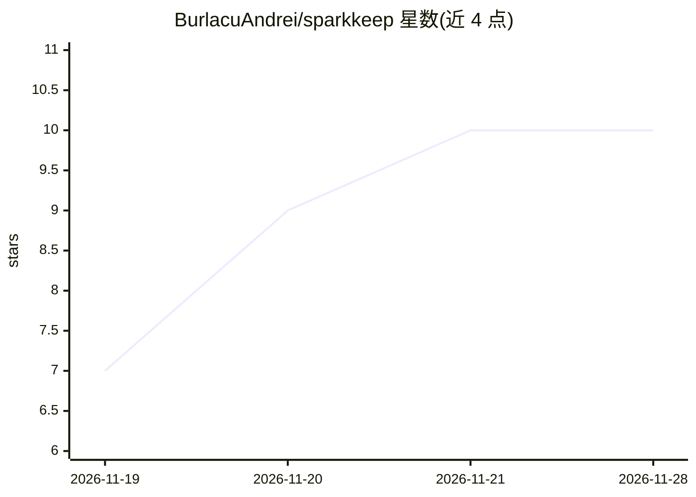

# BurlacuAndrei/sparkkeep

⭐ 10 · TypeScript · NOASSERTION · 推送 2026-11-26 · [GitHub](https://github.com/BurlacuAndrei/sparkkeep) · 个人维护

**自托管 AI 收集与分诊引擎：把链接笔记变成可执行看板**

单二进制 + 单 SQLite 文件的自托管应用：从 Telegram/Discord/Slack/浏览器扩展/webhook 捕获链接、笔记、语音、截图，经噪声过滤后由用户自备的 LLM 生成分诊摘要，路由到 Now/Next/Later 执行看板；支持带引用的确定性研究流水线、7/14/30 天摘要回顾，以及向 Obsidian/Notion/Joplin 的单向导出。BYOK 支持本地与云模型端点，Docker、独立二进制与源码构建三种安装方式。

## 筛选速览

| 维度 | 判定 | 备注 |
|---|---|---|
| AI 角色 | `ai-native` | 本体是模型或模型工具 |
| 许可风险 | `dual` | NOASSERTION |
| 部署形态 | `self-host` | docker 或自建部署 |
| 模型依赖 | local-ok | 支持本地模型 |
| 硬件要求 | — | 无带数字的原话,不猜 |
| 安装摩擦 | `low` | 无编译、无系统依赖或容器化 |
| 成熟度 | — | 结构信号不足 |

## 能力要点

- 捕获→过滤→AI 分诊→看板路由→研究→导出的完整流水线
- BYOK：Ollama/LM Studio/vLLM/OpenAI/DeepSeek 或任意 OpenAI 兼容端点，按角色路由模型
- 零依赖存储：纯 Go SQLite WAL + FTS5，30 MB 内存可运行
- 确定性研究 playbook：5 支柱健康检查、成本估算、零成本演练

## 适用场景

- 把散落在聊天和浏览器里的链接自动整理成执行看板
- 让 AI 对收集的内容生成带引用的研究档案并给出 Pursue/Watch/Skip 判定
- 将处理完成的笔记推送到 Obsidian/Notion/Joplin 知识库
- 在树莓派/NAS 等低配设备上本地运行，数据不出本机

## 场景标签

`知识库管理` `工作流自动化` · 领域:效率与自动化

## 证据(README 行号)

> L5: Sparkkeep is a self-hosted action engine for the ideas you keep collecting and never execute. Share a link, a note, 
> L37: 3. **Synthesize** a brief — TL;DR, why you'd care, and a checklist of next actions — using your own LLM.
> L97: - **Privacy-first BYOK** — Ollama, LM Studio, vLLM, OpenAI, DeepSeek, or any OpenAI-compatible endpoint, with per-r

## 星数曲线

2026-11-19 7 → 2026-11-28 10（+3）

---
*卡片 v1 · prompt 1.4 · 生成 2026-11-20 · 置信度 high · 依据 README sha `8d789262c15d` · [字段定义](../../DATASET.md)*
