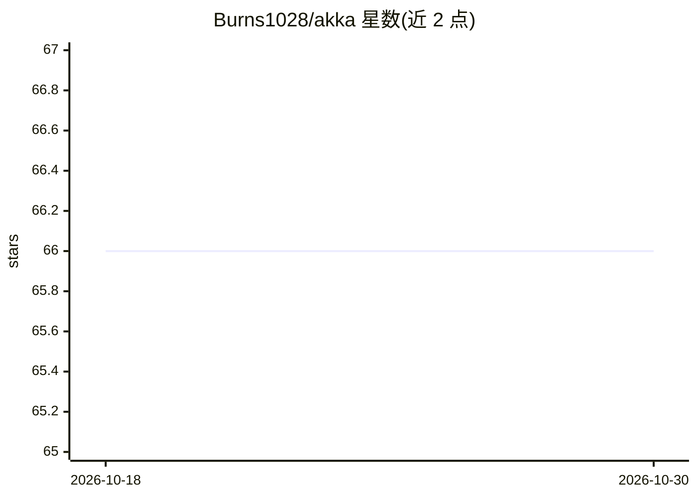

# Burns1028/akka

⭐ 66 · Python · AFL-3.0 · 推送 2026-03-10 · [GitHub](https://github.com/Burns1028/akka) · 组织维护 · 中文 README

**自媒体创作者的全自动内容 Agent：一句话完成选题到发布**

面向自媒体运营者的开源 Creator AI Agent，通过一句话指令完成选题、素材搜索、内容生成与定时发布的完整闭环。核心机制包括浏览器自动化（搜索竞品、采集素材）、三阶段生成流程（大纲→文案→配图）、技能系统（竞品分析、内容创作、定时任务等 5 项）、用户隔离的记忆与人格配置。支持小红书、点评等平台操作。部署方式为 git clone 源码运行，需 Python 3.10+、Node.js 18+、Chrome 浏览器与 OpenAI API key。

## 筛选速览

| 维度 | 判定 | 备注 |
|---|---|---|
| AI 角色 | `ai-native` | 本体是模型或模型工具 |
| 许可风险 | `viral` | AFL-3.0 |
| 部署形态 | `None` |  |
| 模型依赖 | — | README 未给出锁定关系 |
| 硬件要求 | — | 无带数字的原话,不猜 |
| 安装摩擦 | `low` | 无编译、无系统依赖或容器化 |
| 成熟度 | — | 结构信号不足 |

## 能力要点

- 一句话指令完成选题到发布的全自动内容闭环
- 三阶段生成：大纲规划→文案创作→图片生成
- 浏览器自动化采集素材，支持小红书、点评等平台
- 每用户独立 soul.md、memory.md 与工作区，含定时任务与任务锁

## 适用场景

- 让 AI 代替我完成小红书图文笔记的选题、撰写与配图
- 自动采集并分析竞品账号数据作为创作参考
- 设置定时任务在指定时间自动发布内容

## 场景标签

`浏览器自动化` `AI 写作` `图像生成` · 领域:效率与自动化

## 证据(README 行号)

> L28: Akka (**A**utomated **K**nowledge & **K**ontent **A**ssistant) is an open-source **self-learning, 24/7 Creator Agen
> L89: - **Fully Automated Creation**: Automatically generate complete Xiaohongshu (Little Red Book) image-text notes from

## 星数曲线

2026-10-18 66 → 2026-10-30 66（+0）

---
*卡片 v1 · prompt 1.4 · 生成 2026-10-24 · 置信度 high · 依据 README sha `73e13704f5d0` · [字段定义](../../DATASET.md)*
