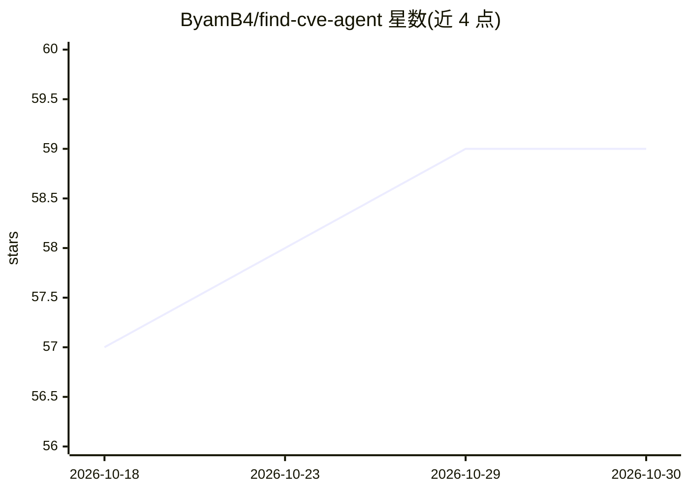

# ByamB4/find-cve-agent

⭐ 59 · JavaScript · Apache-2.0 · 推送 2026-03-20 · [GitHub](https://github.com/ByamB4/find-cve-agent) · 个人维护

**Claude Code 插件：多 agent 流程系统性挖掘开源包 CVE**

面向 Claude Code 的安全研究插件：以 20 个技能组织成 6 角色团队（Director/Recon/Hunter/Exploiter/Validator/Registry），覆盖目标发现、代码审计（命令注入/路径穿越/反序列化等 10 类漏洞搜索）、PoC 编写、6 道门误报消除与 90 天负责任披露报告生成。提供 /hunt、/recon、/fp-check 等 8 个命令。环境要求 git、gh、python3、node、curl，平台为 macOS 或 Linux。声明仅限授权安全研究，Apache-2.0 许可。

## 筛选速览

| 维度 | 判定 | 备注 |
|---|---|---|
| AI 角色 | `ai-ecosystem` | LLM/agent 周边工具 |
| 许可风险 | `permissive` | Apache-2.0 |
| 部署形态 | `library` | 以包/库形式分发 |
| 模型依赖 | — | README 未给出锁定关系 |
| 硬件要求 | — | 无带数字的原话,不猜 |
| 安装摩擦 | `low` | 无编译、无系统依赖或容器化 |
| 成熟度 | — | 结构信号不足 |

## 能力要点

- 20 个技能按 6 角色（Director/Recon/Hunter/Exploiter/Validator/Registry）协作
- 10 类漏洞模式搜索（命令注入、路径穿越、SSRF、XXE、原型污染等）
- 6 道门误报消除流程与版本核验
- 90 天协调披露时间线，PoC 仅本地运行

## 适用场景

- 在开源包中系统性寻找可报告的真实 CVE
- 按类别（如 csv 解析器）批量发现审计不足的目标
- 对已有发现做误报消除与披露报告生成

## 场景标签

`多智能体` `网络安全` · 领域:Agent 开发

## 证据(README 行号)

> L5: A Claude Code plugin that systematically finds real CVEs in open source packages through coordinated multi-agent sec
> L9: `find-cve-agent` is a battle-tested harness of 20 skills organized as a 5-agent team. It provides structured workflo

## 星数曲线

2026-10-18 57 → 2026-10-30 59（+2）

---
*卡片 v1 · prompt 1.4 · 生成 2026-10-24 · 置信度 mid · 依据 README sha `5aa6c12098c4` · [字段定义](../../DATASET.md)*
