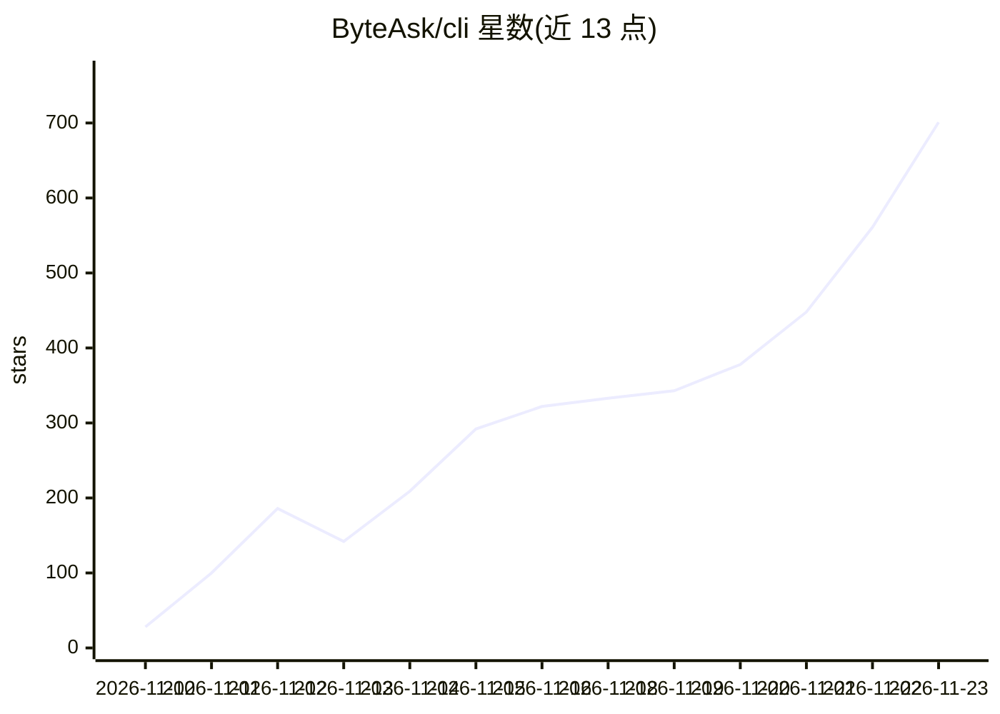

# ByteAsk/cli

⭐ 701 · Rust · Apache-2.0 · 推送 2026-11-22 · [GitHub](https://github.com/ByteAsk/cli) · [官网](https://byteask.ai) · 组织维护

**面向 C/C++ 的终端 AI 编码代理，基于 Codex CLI 分叉**

ByteAsk CLI 是 OpenAI Codex CLI 的分叉，保留终端 agent 能力并为 C/C++ 项目增加原生工具：调用项目自身构建系统构建与选择测试、运行 clang-tidy/cppcheck、ASan/UBSan/TSan、gdb/lldb 调试、rr 录制回放、perf 性能分析等。模型接入支持四种方式：ByteAsk 托管网关（邮箱登录）、自带 OpenAI/Anthropic/Gemini key、ChatGPT 订阅登录、任意 OpenAI 兼容端点（如 vLLM/Ollama）。提供 curl 安装脚本与 pip 安装，支持 Linux/macOS/Windows；每个工具报告其执行的命令与发现。限制：早期二进制发布早于源码公开，需从 docs/byteask/building.md 自行构建。

## 筛选速览

| 维度 | 判定 | 备注 |
|---|---|---|
| AI 角色 | `ai-ecosystem` | LLM/agent 周边工具 |
| 许可风险 | `permissive` | Apache-2.0 |
| 部署形态 | `library` | 以包/库形式分发 |
| 模型依赖 | local-ok | 支持本地模型 |
| 硬件要求 | — | 无带数字的原话,不猜 |
| 安装摩擦 | `low` | 无编译、无系统依赖或容器化 |
| 成熟度 | — | 结构信号不足 |

## 能力要点

- C/C++ 专用工具链：构建、静态检查、sanitizer、调试、profiling
- 支持自有 provider key 与 OpenAI 兼容自托管端点（vLLM/Ollama）
- 可连接 ByteAsk Context 托管代码索引
- 非交互 exec 模式可用于脚本与 CI

## 适用场景

- 在终端用自然语言驱动 C/C++ 项目的修改与调试
- 让 agent 自动运行 sanitizer 与 gdb/lldb 排查问题
- CI 中以 exec 模式执行一次性编码任务

## 场景标签

`编码 Agent` · 领域:编码与开发

## 证据(README 行号)

> L3:  An AI coding agent for your terminal, with tools for C and C++ work: build, debug, sanitize and profile.
> L8: ByteAsk CLI is a fork of OpenAI Codex CLI. It keeps Codex's terminal agent and

## 星数曲线

2026-11-10 28 → 2026-11-23 701（+673）

---
*卡片 v1 · prompt 1.4 · 生成 2026-11-17 · 置信度 high · 依据 README sha `ebc86a660b2e` · [字段定义](../../DATASET.md)*
