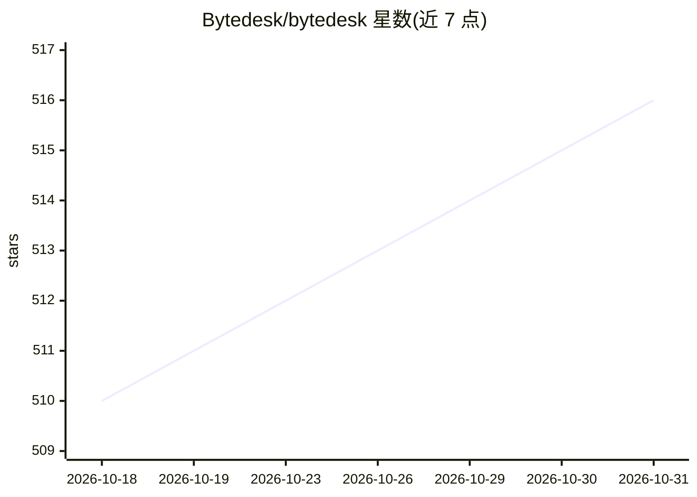

# Bytedesk/bytedesk

⭐ 516 · JavaScript · AGPL-3.0 · 推送 2026-10-27 · [GitHub](https://github.com/Bytedesk/bytedesk) · [官网](https://www.bytedesk.com/en/) · 组织维护 · 中文 README

**面向企业的全渠道客服与团队 IM 开源系统，含 AI Agent**

Bytedesk 提供团队内部 IM（多级组织、角色与权限管理）与全渠道客服系统，覆盖工单 SLA 管理、知识库（内部文档/帮助中心/FAQ）、工作流、反馈调查、基于 FreeSwitch 的呼叫中心与 WebRTC 视频客服。AI Agent 部分支持接入 Ollama/DeepSeek/智谱等对话、知识库 RAG 问答、Function Calling 与 MCP。提供 RESTful API 与多语言 SDK，通过 Docker Compose 或 Maven monorepo 源码部署，默认依赖 MySQL/Artemis 等中间件。许可为自研版权声明附加使用条款，禁止未经许可转售。

## 筛选速览

| 维度 | 判定 | 备注 |
|---|---|---|
| AI 角色 | `ai-enhanced` | 去掉 AI 部分产品仍成立 |
| 许可风险 | `viral` | AGPL-3.0 |
| 部署形态 | `self-host` | docker 或自建部署 |
| 模型依赖 | local-ok | 支持本地模型 |
| 硬件要求 | — | 无带数字的原话,不猜 |
| 安装摩擦 | `low` | 无编译、无系统依赖或容器化 |
| 成熟度 | — | 结构信号不足 |

## 能力要点

- 多渠道客服与工单 SLA 管理、坐席工作台
- AI Agent：多模型接入、知识库 RAG、Function Calling 与 MCP
- 基于 FreeSwitch 的呼叫中心与 WebRTC 视频客服
- RESTful API 与多平台 SDK（iOS/Android/Flutter/UniApp/Web 等）

## 适用场景

- 企业搭建全渠道在线客服与工单系统
- 团队内部沟通 IM 与组织权限管理
- 基于自有知识库的 AI 客服问答

## 场景标签

`聊天机器人` `RAG` · 领域:对话与助手

## 证据(README 行号)

> L3: AI powered Omnichannel customer service With Team IM
> L58: - Chat with Ollama/DeepSeek/ZhipuAI/...

## 星数曲线

2026-10-18 510 → 2026-10-31 516（+6）

---
*卡片 v1 · prompt 1.4 · 生成 2026-10-21 · 置信度 high · 依据 README sha `5459f6436628` · [字段定义](../../DATASET.md)*
