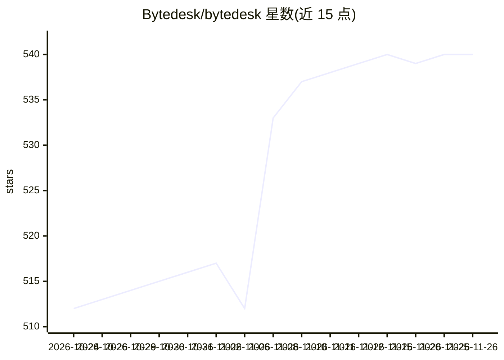

# Bytedesk/bytedesk

⭐ 540 · JavaScript · AGPL-3.0 · 推送 2026-11-21 · [GitHub](https://github.com/Bytedesk/bytedesk) · [官网](https://www.bytedesk.com/en/) · 组织维护 · 中文 README

**给企业的 AI 全渠道客服与团队 IM 一体化平台**

开源客服平台，整合团队 IM（多级组织/角色/权限）、全渠道客服（多渠道路由策略、坐席工作台）、知识库（内部文档/帮助中心/FAQ）、工单管理与 SLA 统计、AI Agent（对接 Ollama/DeepSeek 等本地与 API 模型，支持 RAG 知识库问答、function calling 与 MCP）、基于 FreeSwitch 的呼叫中心与 WebRTC 视频客服。提供 RESTful API 与多语言 SDK，桌面/移动/Web 等客户端，通过 Docker Compose 部署，依赖 MySQL、Redis、Elasticsearch、Artemis 等中间件。

## 筛选速览

| 维度 | 判定 | 备注 |
|---|---|---|
| AI 角色 | `ai-ecosystem` | LLM/agent 周边工具 |
| 许可风险 | `viral` | AGPL-3.0 |
| 部署形态 | `self-host` | docker 或自建部署 |
| 模型依赖 | local-ok | 支持本地模型 |
| 硬件要求 | — | 无带数字的原话,不猜 |
| 安装摩擦 | `low` | 无编译、无系统依赖或容器化 |
| 成熟度 | — | 结构信号不足 |

## 能力要点

- AI Agent 支持 Ollama/DeepSeek 等模型、RAG 知识库问答、function calling 与 MCP
- 全渠道客服：多渠道路由策略、坐席工作台与考核指标
- 工单管理与 SLA 统计、知识库/帮助中心/FAQ
- 基于 FreeSwitch 的呼叫中心与 WebRTC 视频客服

## 适用场景

- 搭建带 AI 机器人辅助的全渠道在线客服系统
- 企业内部团队 IM 与工单支持一体化管理
- 构建内部文档知识库并接入 RAG 问答
- 部署语音/视频客服与呼叫中心

## 场景标签

`聊天机器人` `RAG` `文档问答` · 领域:对话与助手

## 证据(README 行号)

> L3: AI powered Omnichannel customer service With Team IM
> L58: - Chat with Ollama/DeepSeek/ZhipuAI/...
> L96: ### Option 1: Docker Compose Only (Quick Verification)

## 星数曲线

2026-10-24 512 → 2026-11-26 540（+28）

---
*卡片 v1 · prompt 1.4 · 生成 2026-11-25 · 置信度 high · 依据 README sha `3caf5b9e7d4d` · [字段定义](../../DATASET.md)*
