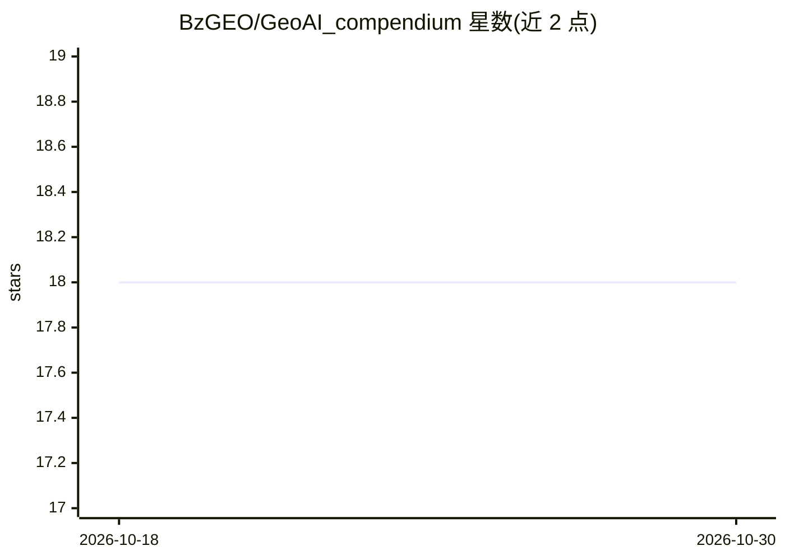

# BzGEO/GeoAI_compendium

⭐ 18 · Apache-2.0 · 推送 2026-10-29 · [GitHub](https://github.com/BzGEO/GeoAI_compendium) · 个人维护

**GeoAI/GeoML 参考资源汇编：聚焦土地覆盖监测的机器学习教程清单**

由 BzGEO 维护的地理空间人工智能与机器学习资源汇编，聚焦土地覆盖监测方向。按经典机器学习、深度学习、不确定性/精度评估等类别组织，收录覆盖 ArcGIS Pro、QGIS、ENVI、SNAP、Google Earth Engine、R 等桌面与云平台的教程、幻灯片、Colab 笔记本与示例脚本，并比较各平台 ML 方法的限制与工作流复现方式。资源以文档清单形式提供，标注自身为进行中的工作（work in progress）。

## 筛选速览

| 维度 | 判定 | 备注 |
|---|---|---|
| AI 角色 | `ai-knowledge` | 知识聚合/清单类 |
| 许可风险 | `permissive` | Apache-2.0 |
| 部署形态 | `None` |  |
| 模型依赖 | — | README 未给出锁定关系 |
| 硬件要求 | — | 无带数字的原话,不猜 |
| 安装摩擦 | `low` | 无编译、无系统依赖或容器化 |
| 成熟度 | `idea` | |

## 能力要点

- 覆盖经典 ML（K-means、SVM、Random Forest 等）与深度学习两大类资源
- 横跨 ArcGIS/QGIS/ENVI/SNAP/GEE/R 等桌面与云平台的教程与示例脚本
- 含不确定性/精度评估与 AREA2 工具箱等统计最佳实践资源
- 收录 Esri 预训练地学深度学习模型与 SAM 使用说明等链接

## 适用场景

- 为土地覆盖分类项目寻找各 GIS 平台的 ML 实现教程
- 比较不同平台间机器学习工作流并尝试复现
- 了解地学深度学习模型（如 Prithvi、SAM）的入口资源

## 场景标签

`教程课程` `精选清单` · 领域:学习与行业

## 证据(README 行号)

> L1: # Geospatial Artificial Intelligence (GeoAI) / Geospatial Machine Learning (GeoML) Compendium:
> L22: * Document the various Machine Learning approaches available across various [desktop + cloud] platforms (e.g. ArcGI
> L41: ## 3. Resources: Machine learning (classical / traditional)

## 星数曲线

2026-10-18 18 → 2026-10-30 18（+0）

---
*卡片 v1 · prompt 1.4 · 生成 2026-10-29 · 置信度 high · 依据 README sha `b69fef35eb01` · [字段定义](../../DATASET.md)*
