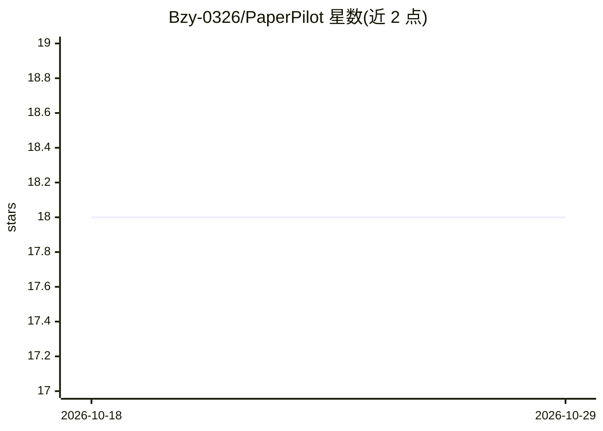

# Bzy-0326/PaperPilot

⭐ 18 · Python · MIT · 推送 2026-03-31 · [GitHub](https://github.com/Bzy-0326/PaperPilot) · 个人维护 · 中文 README

**面向研究者的 AI 论文推荐与阅读决策助手**

基于 Next.js + FastAPI 的自部署 Web 应用：输入研究主题后对论文做排序推荐，支持 2-3 篇候选论文并排对比，详情页给出推荐结论、方法、创新点与局限性，并提供待读/复现/选题备选的跟进清单；下载的 PDF 会自动整理为带标题和日期的文件名。模型层走 OpenAI-compatible API 或本地 Ollama，默认 Demo 模式无需 API Key，但返回内置样例而非实时分析。部署以 Docker Compose 为主，数据存 SQLite。

## 筛选速览

| 维度 | 判定 | 备注 |
|---|---|---|
| AI 角色 | `ai-native` | 本体是模型或模型工具 |
| 许可风险 | `permissive` | MIT |
| 部署形态 | `self-host` | docker 或自建部署 |
| 模型依赖 | local-ok | 支持本地模型 |
| 硬件要求 | — | 无带数字的原话,不猜 |
| 安装摩擦 | `low` | 无编译、无系统依赖或容器化 |
| 成熟度 | — | 结构信号不足 |

## 能力要点

- 同主题论文排序推荐与 2-3 篇并排对比
- 面向决策的详情页：推荐结论/方法/创新点/局限性/复现信息
- 待读、复现、选题备选三类跟进清单
- 三种模型路径：内置 Demo / 自有 API Key / 本地 Ollama

## 适用场景

- 找到一批论文后决定先精读哪几篇
- 比较多篇相似论文哪篇更值得复现
- 把有价值的论文纳入待读与跟进流程

## 场景标签

`科研工具` `推荐系统` · 领域:学习与行业

## 证据(README 行号)

> L10: PaperPilot 是一个面向研究者的 AI 论文推荐与决策助手。
> L379: - OpenAI-compatible API providers

## 星数曲线

2026-10-18 18 → 2026-10-29 18（+0）

---
*卡片 v1 · prompt 1.4 · 生成 2026-10-29 · 置信度 high · 依据 README sha `c22dd8b1d8a0` · [字段定义](../../DATASET.md)*
