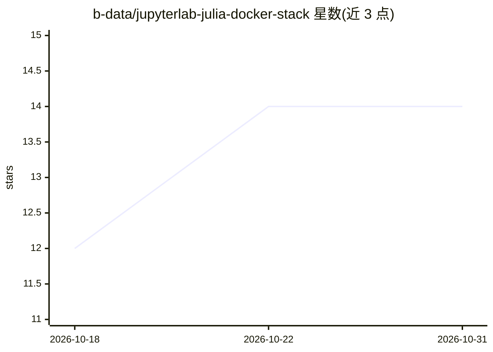

# b-data/jupyterlab-julia-docker-stack

⭐ 14 · Dockerfile · NOASSERTION · 推送 2026-10-30 · [GitHub](https://github.com/b-data/jupyterlab-julia-docker-stack) · [官网](https://gitlab.com/b-data/jupyterlab/julia/docker-stack) · 组织维护

**面向 Julia 数据科学的 JupyterLab 多架构 Docker 镜像栈**

b-data GmbH 维护的 JupyterLab Julia Docker 镜像系列，覆盖 linux/amd64 与 linux/arm64/v8 双架构（可在 Apple M 系列上经 Docker Desktop 运行），Julia 版本 ≥1.7.3 视为稳定。镜像内置 JupyterLab、code-server（浏览器版 Code - OSS）、Git/Git LFS、Python、Pandoc、Quarto、Zsh 等工具，pubtools 子镜像额外含 TinyTeX；提供 devtools/docker 等子标签及若干 code-server 扩展。使用需自行安装 Docker，支持 Podman rootless 运行；另有基于 CUDA 的 GPU 镜像栈另行发布。

## 筛选速览

| 维度 | 判定 | 备注 |
|---|---|---|
| AI 角色 | `ai-enhanced` | 去掉 AI 部分产品仍成立 |
| 许可风险 | `none` | NOASSERTION |
| 部署形态 | `self-host` | docker 或自建部署 |
| 模型依赖 | — | README 未给出锁定关系 |
| 硬件要求 | — | 无带数字的原话,不猜 |
| 安装摩擦 | `low` | 无编译、无系统依赖或容器化 |
| 成熟度 | — | 结构信号不足 |

## 能力要点

- linux/amd64 与 linux/arm64/v8 双架构镜像
- 内置 JupyterLab 与 code-server（Code - OSS）双 IDE
- devtools/docker 等 subtag 组合及预装 code-server 扩展
- 支持 Podman rootless 模式运行（1.9.4+）

## 适用场景

- 在容器中开箱获得 Julia + JupyterLab 的数据科学环境
- 在浏览器中使用 VS Code 风格 IDE 编写 Julia 代码
- 在 Apple M 系列或 arm64 设备上运行 Julia 开发环境

## 场景标签

 · 领域:数据科学/开发环境

## 证据(README 行号)

> L8: Multi-arch (`linux/amd64`, `linux/arm64/v8`) docker images:
> L29: * **JupyterLab**: A web-based interactive development environment for Jupyter
> L36:  * **Julia**: A high-level, high-performance dynamic language for technical

## 星数曲线

2026-10-18 12 → 2026-10-31 14（+2）

---
*卡片 v1 · prompt 1.4 · 生成 2026-10-31 · 置信度 low · 依据 README sha `5e3a0de0273d` · [字段定义](../../DATASET.md)*
