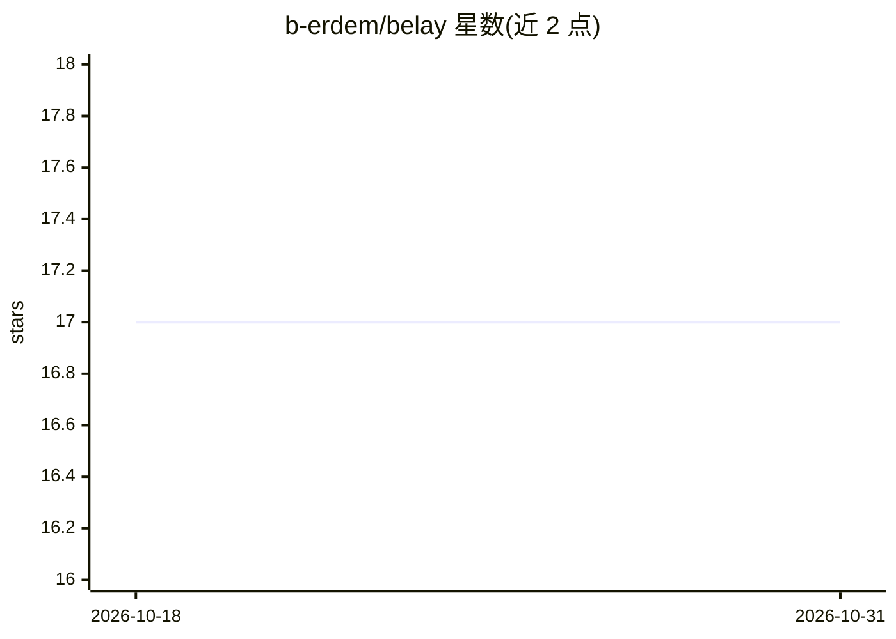

# b-erdem/belay

⭐ 17 · Elixir · Apache-2.0 · 推送 2026-08-18 · [GitHub](https://github.com/b-erdem/belay) · 个人维护

**基于 Postgres 的 Elixir 持久化任务引擎：步骤级重试续跑**

Belay 是 Elixir 的持久化执行/后台任务引擎，数据全部存于 PostgreSQL（14–18），无 Redis 与独立服务依赖。以步骤为恢复单元：步骤结果提交到 journal 后，重试从首个未完成步骤续跑而非重跑整个任务。提供美元/token 双层预算与花费控制、human-in-the-loop 等待、工作流 DAG、事件流、replay 调试、内嵌仪表盘，以及 MCP server 供 AI 助手查看队列；面向含 LLM/agent 调用的多步骤任务场景，并带 Oban 迁移命令。1.0.0 版本，README 声明生产采用尚处早期。

## 筛选速览

| 维度 | 判定 | 备注 |
|---|---|---|
| AI 角色 | `ai-enhanced` | 去掉 AI 部分产品仍成立 |
| 许可风险 | `permissive` | Apache-2.0 |
| 部署形态 | `None` |  |
| 模型依赖 | — | README 未给出锁定关系 |
| 硬件要求 | — | 无带数字的原话,不猜 |
| 安装摩擦 | `low` | 无编译、无系统依赖或容器化 |
| 成熟度 | `idea` | |

## 能力要点

- 步骤级 journal 恢复：重试从首个未完成步骤续跑
- 引擎内三层预算与持久化花费核算（美元/token）
- 工作流 DAG、human-in-the-loop、事件流与 replay 调试
- mix belay.migrate_oban 一条命令迁移 Oban 待处理任务

## 适用场景

- 跑含多次付费 API 调用与人工审批的多步骤任务，重试不重跑已完成步骤
- 为 LLM/agent 管道设置每任务美元/token 花费上限
- 从 Oban 迁移现有后台任务到持久化步骤引擎
- 通过 MCP 让 AI 助手检查队列状态

## 场景标签

`工作流自动化` · 领域:效率与自动化

## 证据(README 行号)

> L2:  Durable execution for Elixir — without a workflow server.
> L84: cost, and LLM/agent pipelines where each API call is a journaled step with

## 星数曲线

2026-10-18 17 → 2026-10-31 17（+0）

---
*卡片 v1 · prompt 1.4 · 生成 2026-10-29 · 置信度 high · 依据 README sha `c5636a31a7e6` · [字段定义](../../DATASET.md)*
