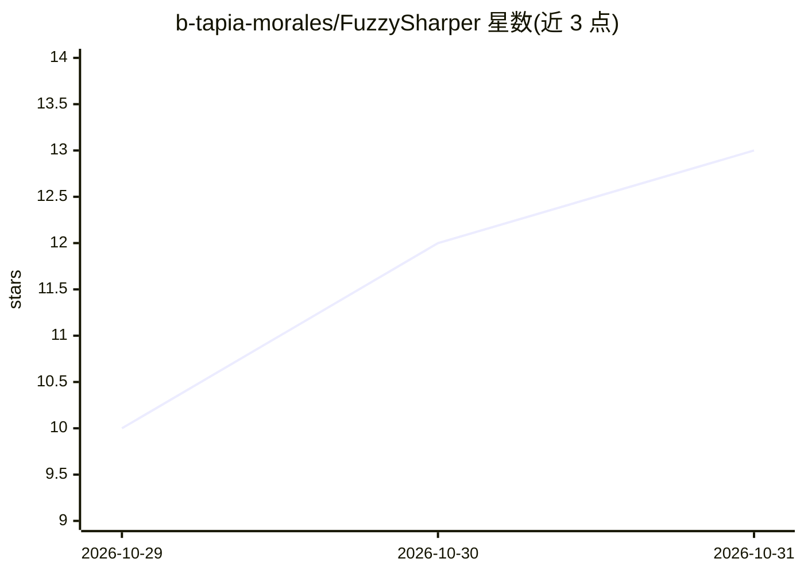

# b-tapia-morales/FuzzySharper

⭐ 13 · C# · MIT · 推送 2026-10-24 · [GitHub](https://github.com/b-tapia-morales/FuzzySharper) · 个人维护

**C# 模糊逻辑推理库：组件化搭建模糊专家系统**

面向 .NET 开发者的模糊推理库，将规则、命题、算子、蕴含方法等作为可独立组合的组件，通过显式组合构成推理引擎，不强制单一推理模型。提供 8 种内置隶属函数（三角、梯形、高斯等）、语言变量与语言库、工作记忆（支持数值/类别事实及 CSV 加载）、模糊命题与布尔命题混合的规则，支持 Mamdani 式模糊集规则与 Sugeno 式函数式规则及多种系数初始化策略。依赖 .NET SDK 10 及 SmartEnum、Math.NET Numerics 等库。限制：README 未给出安装命令与最终推理执行示例。

## 筛选速览

| 维度 | 判定 | 备注 |
|---|---|---|
| AI 角色 | `ai-native` | 本体是模型或模型工具 |
| 许可风险 | `permissive` | MIT |
| 部署形态 | `None` |  |
| 模型依赖 | — | README 未给出锁定关系 |
| 硬件要求 | — | 无带数字的原话,不猜 |
| 安装摩擦 | `low` | 无编译、无系统依赖或容器化 |
| 成熟度 | — | 结构信号不足 |

## 能力要点

- 8 种内置隶属函数，自定义函数可扩展
- 工作记忆支持数值/类别事实及 CSV 文件加载
- 规则可混合模糊命题与布尔命题
- 支持 Mamdani 式与 Sugeno 式规则及系数初始化策略

## 适用场景

- 用 C# 搭建模糊控制系统（如温控、HVAC 类规则）
- 以自然语言式规则构建领域专家系统
- 从 CSV 数据初始化推理输入进行模糊推断

## 场景标签

 · 领域:模糊逻辑/知识工程

## 证据(README 行号)

> L5: Fuzzy Sharper is a library that allows you to create your own Fuzzy Expert System.
> L9: **FuzzySharper** is a fuzzy logic inference library built around explicit composition of inference components.

## 星数曲线

2026-10-29 10 → 2026-10-31 13（+3）

---
*卡片 v1 · prompt 1.4 · 生成 2026-10-31 · 置信度 high · 依据 README sha `1a6f6d4b0fcb` · [字段定义](../../DATASET.md)*
