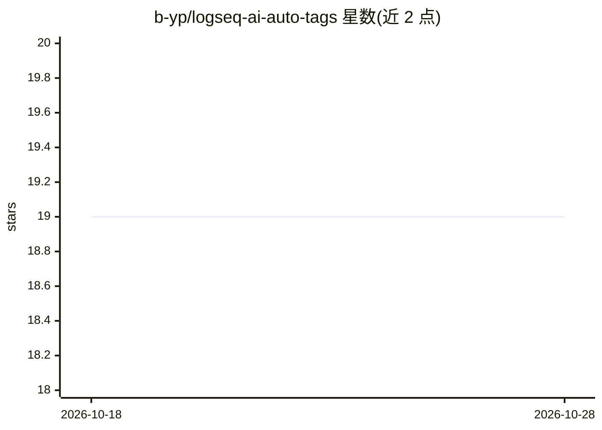

# b-yp/logseq-ai-auto-tags

⭐ 19 · TypeScript · MIT · 推送 2026-07-24 · [GitHub](https://github.com/b-yp/logseq-ai-auto-tags) · 个人维护

**为 Logseq 块和页面自动生成 AI 标签的插件**

Logseq 笔记软件插件：通过斜杠命令、块右键菜单或页面菜单触发，将块（含子块）或整页内容发送到用户配置的 OpenAI 兼容 API，用系统提示提取最多 5 个与内容同语言的核心概念，格式化为 #tag 或 #[[tag with spaces]] 后写回块尾或页面 tags:: 属性。支持 Ollama、LM Studio 等本地端点和 OpenAI/OpenRouter/Groq 云端；硬编码每次最多 5 个标签，超长页面可能受 token 限制，标签质量依赖所选模型。经 Logseq Marketplace 安装或从源码构建。

## 筛选速览

| 维度 | 判定 | 备注 |
|---|---|---|
| AI 角色 | `ai-enhanced` | 去掉 AI 部分产品仍成立 |
| 许可风险 | `permissive` | MIT |
| 部署形态 | `None` |  |
| 模型依赖 | local-ok | 支持本地模型 |
| 硬件要求 | — | 无带数字的原话,不猜 |
| 安装摩擦 | `low` | 无编译、无系统依赖或容器化 |
| 成熟度 | — | 结构信号不足 |

## 能力要点

- 块级与页面级双模式自动打标签，标签语言与内容语言一致
- 兼容任意 OpenAI 兼容 API（Ollama/LM Studio 本地，OpenRouter/Groq/OpenAI 云端）
- 无空格标签输出 #tag，含空格标签自动格式化为 #[[tag with spaces]]
- 每次请求硬编码最多生成 5 个标签

## 适用场景

- 给笔记块或整页批量补充主题标签，省去手工打标
- 配合本地 Ollama 实现完全离线、数据不出机的标签生成
- 多语言笔记（中英文）保持标签与内容同语言

## 场景标签

`知识库管理` · 领域:知识与检索

## 证据(README 行号)

> L3: A Logseq plugin that uses artificial intelligence to automatically generate relevant tags for your blocks and pages.
> L79: 2. **AI Analysis**: The content is sent to your AI provider with an optimized system prompt instructing the AI to e

## 星数曲线

2026-10-18 19 → 2026-10-28 19（+0）

---
*卡片 v1 · prompt 1.4 · 生成 2026-10-28 · 置信度 high · 依据 README sha `5b7a1791a57b` · [字段定义](../../DATASET.md)*
