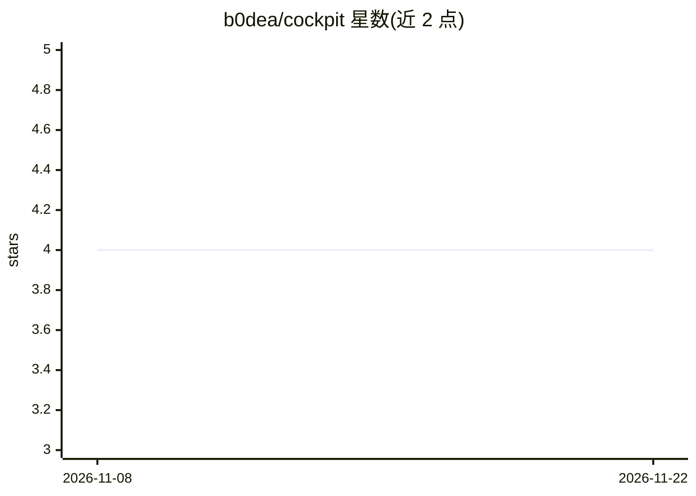

# b0dea/cockpit

⭐ 4 · TypeScript · MIT · 推送 2026-11-20 · [GitHub](https://github.com/b0dea/cockpit) · 个人维护

**为多编码代理统一环境与守则的 CLI：一套配置驱动 Claude Code、Codex、OpenCode**

面向在真实产品上运行编码代理的开发者的开源 CLI：用户编写一份 cockpit.toml 并像代码一样评审，cockpit 将其渲染到各代理工具自身的配置文件（CLAUDE.md、AGENTS.md、.claude/settings.json、.codex、.opencode），实现指令、技能、权限与一个守卫钩子在三个工具中一致，并通过 check 命令与 CI 检测漂移。守卫拒绝推送到受保护分支、读取 .env 等密钥文件及触及生产主机的命令；session 命令按声明的 Docker Compose 在各自端口上运行产品栈；可选工作单让另一个只读代理按用户设定的标准评分变更。不含产品代码，非沙箱。

## 筛选速览

| 维度 | 判定 | 备注 |
|---|---|---|
| AI 角色 | `ai-ecosystem` | LLM/agent 周边工具 |
| 许可风险 | `permissive` | MIT |
| 部署形态 | `self-host` | docker 或自建部署 |
| 模型依赖 | — | README 未给出锁定关系 |
| 硬件要求 | — | 无带数字的原话,不猜 |
| 安装摩擦 | `low` | 无编译、无系统依赖或容器化 |
| 成熟度 | — | 结构信号不足 |

## 能力要点

- 一份 cockpit.toml 渲染为 Claude Code、Codex、OpenCode 各自的配置文件
- 统一守卫钩子：拒绝推送受保护分支、读取 .env、触及声明的主机等阻塞项
- session 命令在租用端口上按 checkout 运行 Docker Compose 栈，支持 worktree 并行
- 可选工作单由独立只读代理按设定标准评分，可选 Playwright 浏览器取证

## 适用场景

- 让多个编码代理在多仓库产品上遵循同一套指令与权限
- 防止代理推送受保护分支或读取密钥文件
- 多代理并行开发时避免端口与数据库冲突
- 要求代码变更满足独立评分标准后才签收

## 场景标签

 · 领域:开发者工具/AI 编码基础设施

## 证据(README 行号)

> L16: cockpit is an open-source CLI for people who run Claude Code,
> L42: cockpit fixes the environment, not the agent.
> L145: `sync` renders it into each tool's own files, and `check` fails when any stops matching:

## 星数曲线

2026-11-08 4 → 2026-11-22 4（+0）

---
*卡片 v1 · prompt 1.4 · 生成 2026-11-21 · 置信度 mid · 依据 README sha `429c2e0cb996` · [字段定义](../../DATASET.md)*
