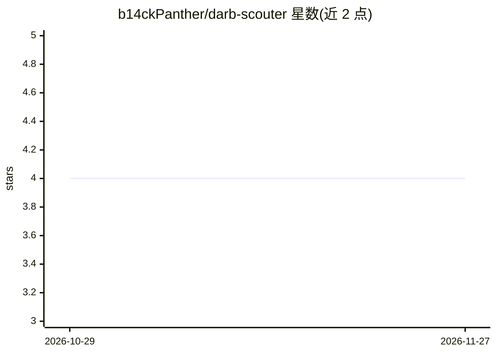

# b14ckPanther/darb-scouter

⭐ 4 · Python · MIT · 推送 2026-10-28 · [GitHub](https://github.com/b14ckPanther/darb-scouter) · [官网](https://darb-scouter.vercel.app) · 个人维护

**每日抓取以色列初级职位并与你的简历逐条比对打分**

一个面向求职者的职位筛选与申请跟踪系统：每天定时读取 FreeHire 与公司招聘板（Greenhouse/Lever/Comeet）的职位，用 LangGraph 流水线让 Claude 提取带原文引证的结构化要求，校验引证后由确定性 Python 代码计算万分制匹配分；职位入 Elasticsearch 做英希双语混合检索，最佳匹配推送 Telegram，申请按七个里程碑跟踪。分数默认关闭自动扫描、支持按需扫描；需 Docker 与 Anthropic API key 运行完整系统，前端可无 key 演示。

## 筛选速览

| 维度 | 判定 | 备注 |
|---|---|---|
| AI 角色 | `ai-native` | 本体是模型或模型工具 |
| 许可风险 | `permissive` | MIT |
| 部署形态 | `self-host` | docker 或自建部署 |
| 模型依赖 | locked-api |  |
| 硬件要求 | — | 无带数字的原话,不猜 |
| 安装摩擦 | `low` | 无编译、无系统依赖或容器化 |
| 成熟度 | — | 结构信号不足 |

## 能力要点

- 每条评分依据都附职位原文引证，无法引证的要求不计分
- LLM 只负责阅读提取，评分由可复现的 Python 代码完成
- BM25 与 multilingual E5 向量混合检索，支持希伯来语与英语互查
- 按职位哈希与模型缓存提取结果，更新技能无需重新调用模型

## 适用场景

- 每天早晨自动筛出与我的简历匹配度最高的新职位
- 查看每个匹配分背后的逐条要求依据，决定练哪个技能
- 用里程碑跟踪从投递到 offer 的求职进度
- 把配置改成其他国家或公司招聘板后复用

## 场景标签

`语义搜索` `网页抓取` `工作流自动化` · 领域:效率与自动化

## 证据(README 行号)

> L3: **Reads every new junior software job in Israel each morning, checks it against my CV, and tells me honestly how wel
> L44: 3. **Extract.** A LangGraph pipeline asks Claude for the requirements as typed, structured output. The model only r
> L15: I wanted the opposite: a number I can trust because I can check it. Darb Scouter gives each job a **match score out

## 星数曲线

2026-10-29 4 → 2026-11-27 4（+0）

---
*卡片 v1 · prompt 1.4 · 生成 2026-11-21 · 置信度 high · 依据 README sha `83ef5d7d9aef` · [字段定义](../../DATASET.md)*
