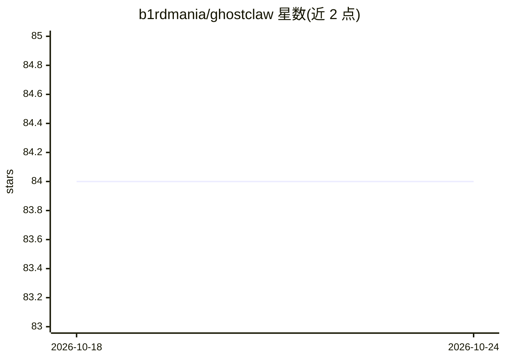

# b1rdmania/ghostclaw

⭐ 78 · TypeScript · MIT · 推送 2026-10-24 · [GitHub](https://github.com/b1rdmania/ghostclaw) · [官网](https://ghostclaw.io) · 个人维护

**运行在自有电脑上的 Telegram 个人 AI agent（NanoClaw 裸机分支）**

GhostClaw 是 NanoClaw 的分支，去除 Docker 容器，agent 以 Node.js 子进程直接运行并获得整机访问（bash、文件、网络、邮件）。以 Telegram 为主要界面，v0.8.0 起仅通过 Anthropic API 运行（Claude Max/OAuth 已移除），按 token 计费，提供每日预算上限与用量记录。内置任务调度、自主任务循环（Ralph loops）、每群独立人格配置、localhost:3333 控制面板，并可通过命令安装 46 个技能（语音转写、Gmail、Slack 等）。面向想在备用电脑上运行个人 agent 的独立开发者。需 Node.js 20+、Anthropic API key 与 Telegram 账号，macOS/Linux 可用。

## 筛选速览

| 维度 | 判定 | 备注 |
|---|---|---|
| AI 角色 | `ai-native` | 本体是模型或模型工具 |
| 许可风险 | `permissive` | MIT |
| 部署形态 | `library` | 以包/库形式分发 |
| 模型依赖 | locked-api |  |
| 硬件要求 | — | 无带数字的原话,不猜 |
| 安装摩擦 | `low` | 无编译、无系统依赖或容器化 |
| 成熟度 | — | 结构信号不足 |

## 能力要点

- 无容器裸机运行，agent 拥有 bash/文件/网络/邮件的整机访问
- v0.8.0 起仅支持 Anthropic API 直连，每轮记录 usage_events 并可设每日预算上限
- Ralph loops 自主多任务循环与自然语言/cron 定时任务
- 46 个可选技能（Gmail、语音转写/TTS、Slack、多 bot 团队等），安装前做安全扫描

## 适用场景

- 把闲置电脑变成通过 Telegram 对话操控的个人 AI agent
- 让 agent 夜间自主逐项完成待办清单
- 每天定时获取早报或定时执行检查任务

## 场景标签

`AI 助手` · 领域:对话与助手

## 证据(README 行号)

> L19: The OpenClaw alternative that actually works. A bare-metal fork of NanoClaw — containers stripped, full system acce
> L34: GhostClaw started as a NanoClaw fork with one question: what if you ripped out everything that makes self-hosting p
> L95: You (Telegram) → GhostClaw → Claude (Agent SDK) → Response

## 星数曲线

2026-10-18 84 → 2026-10-24 84（+0）

---
*卡片 v1 · prompt 1.4 · 生成 2026-10-24 · 置信度 high · 依据 README sha `71f3cf6c6110` · [字段定义](../../DATASET.md)*
