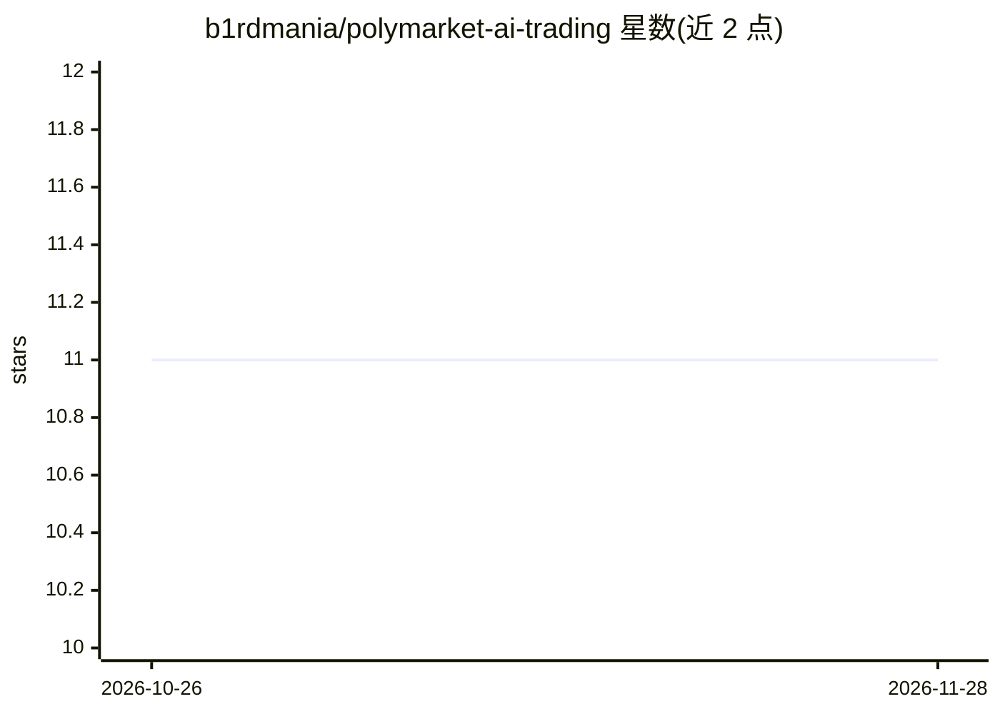

# b1rdmania/polymarket-ai-trading

⭐ 11 · Python · 推送 2026-02-03 · [GitHub](https://github.com/b1rdmania/polymarket-ai-trading) · [官网](https://polymarket-trading-dashboard.vercel.app) · 个人维护

**AI 驱动的 Polymarket 预测市场模拟交易系统**

面向 Polymarket 预测市场的量化交易系统：基于均值回归策略运行保守/稳健/激进三个并行模型，以 GPT-4o-mini 进行市场分析与质量评分（流动性、价差、活跃度、清晰度），并用向量嵌入做语义市场检索。当前仅运行在 paper trading 模式，不含真实资金与钱包集成；系统由 4 个 Docker 容器组成（三个模型加 FastAPI 仪表盘），支持本地 Docker 运行或部署到 Render，提供实时监控仪表盘。

## 筛选速览

| 维度 | 判定 | 备注 |
|---|---|---|
| AI 角色 | `ai-native` | 本体是模型或模型工具 |
| 许可风险 | `none` | — |
| 部署形态 | `None` |  |
| 模型依赖 | — | README 未给出锁定关系 |
| 硬件要求 | — | 无带数字的原话,不猜 |
| 安装摩擦 | `low` | 无编译、无系统依赖或容器化 |
| 成熟度 | `idea` | |

## 能力要点

- 三个并行交易模型（保守/稳健/激进）共享均值回归策略、不同风险参数
- GPT-4o-mini 市场分析 + text-embedding-3-small 语义市场检索
- paper trading 模式运行，无需钱包私钥、不涉及真实资金
- 4 容器 Docker 架构，支持本地运行与 Render 一键部署

## 适用场景

- 在不投入真实资金的情况下测试预测市场交易策略
- 实时监控 Polymarket 市场信号与模型表现
- 研究均值回归与 Kelly 公式在预测市场的应用

## 场景标签

`金融量化` · 领域:学习与行业

## 证据(README 行号)

> L11: An AI-powered trading system for Polymarket that:
> L15: - Uses **OpenAI GPT-4o-mini** for market analysis and quality scoring
> L28: - ✅ AI-powered market analysis (GPT-4o-mini + embeddings)

## 星数曲线

2026-10-26 11 → 2026-11-28 11（+0）

---
*卡片 v1 · prompt 1.4 · 生成 2026-11-18 · 置信度 high · 依据 README sha `1f7d591d7af3` · [字段定义](../../DATASET.md)*
