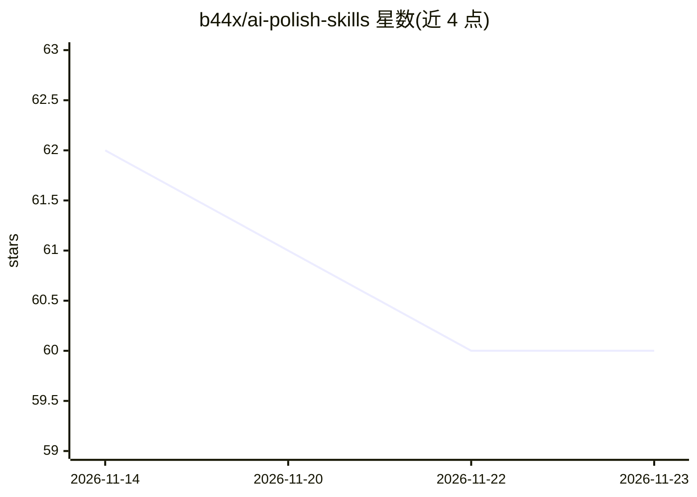

# b44x/ai-polish-skills

⭐ 60 · Python · MIT · 推送 2026-11-19 · [GitHub](https://github.com/b44x/ai-polish-skills) · [官网](https://polskieskille.pl) · 个人维护

**面向 AI agent 的波兰 API/公共服务技能注册目录（26 个技能）**

面向 Claude Code、Cursor、Windsurf 等 agent 的开源技能注册表与安装器：收录 26 个 SKILL.md 格式技能，接入波兰官方与公共 API（KRS 公司登记、NBP 汇率、NFZ 候诊队列、GUGiK 地籍、IMGW 气象、GIOŚ 空气质量、药品注册等）。技能脚本零 pip 依赖，基于 Python 3.8+ 标准库，输出确定性 JSON 到 stdout。提供 bash install.sh 安装器与 CLI 检索，默认安装到 .claude/skills 或 .agents/skills；部分数据源为逆向或社区 API（如 Filmweb），数据覆盖范围在各技能中声明限制。

## 筛选速览

| 维度 | 判定 | 备注 |
|---|---|---|
| AI 角色 | `ai-knowledge` | 知识聚合/清单类 |
| 许可风险 | `permissive` | MIT |
| 部署形态 | `None` |  |
| 模型依赖 | — | README 未给出锁定关系 |
| 硬件要求 | — | 无带数字的原话,不猜 |
| 安装摩擦 | `low` | 无编译、无系统依赖或容器化 |
| 成熟度 | — | 结构信号不足 |

## 能力要点

- 26 个技能接入波兰官方/公共 API（KRS、NBP、NFZ、GUGiK、IMGW 等）
- SKILL.md 标准格式：YAML manifest + Markdown 指令 + CLI 脚本
- 零 pip 依赖，纯 Python 3.8+ 标准库，JSON 到 stdout、错误到 stderr
- install.sh 支持按需安装技能，可指定 .claude/.agents/自定义目录

## 适用场景

- 让 Claude Code/Cursor/Windsurf 查询波兰公司登记、汇率、公共数据
- agent 需要药品说明书、NFZ 候诊时间等波兰公共服务信息时调用
- 按 SKILL.md 标准为自有 agent 安装或编写波兰数据技能

## 场景标签

 · 领域:AI agent 技能/开放数据

## 证据(README 行号)

> L5: Oficjalny rejestr i katalog otwartych skilli dla agentów sztucznej inteligencji, dostosowanych do **polskiego rynku,
> L20: **ai-polish-skills** to ekosystem modularnych rozszerzeń dla agentów AI, które dają modelom bezpośredni dostęp do p
> L30: `SKILL.md` to otwarty format instrukcji dla agentów AI. Każdy folder w `skills/<nazwa>` zawiera plik `SKILL.md` zło

## 星数曲线

2026-11-14 62 → 2026-11-23 60（-2）

---
*卡片 v1 · prompt 1.4 · 生成 2026-11-18 · 置信度 high · 依据 README sha `e87f9fef8e53` · [字段定义](../../DATASET.md)*
