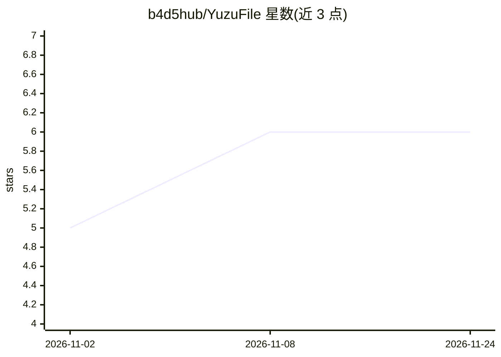

# b4d5hub/YuzuFile

⭐ 6 · Python · 推送 2026-11-01 · [GitHub](https://github.com/b4d5hub/YuzuFile) · 个人维护

**Windows 本地 PDF/文档处理工具箱，端侧 AI 识别**

常驻系统托盘的 Windows 桌面工具箱，通过托盘菜单或 Explorer 中拖拽文件按 Shift 呼出浮动工具轮调用功能：神经 OCR 生成可检索 PDF、转 Markdown/Word（含表格重建与 RTL 阿拉伯语）、三级压缩、书页切分、可视化页面整理与清洁。采用 Qt 桌面进程 + 隔离 worker 双进程架构，经 Windows Job Object 限制 CPU/内存。需下载模型后完全本地运行，无云端上传与 API key。当前为 0.27.0 personal-use 构建，许可与公开分发尚未就绪。

## 筛选速览

| 维度 | 判定 | 备注 |
|---|---|---|
| AI 角色 | `ai-enhanced` | 去掉 AI 部分产品仍成立 |
| 许可风险 | `none` | — |
| 部署形态 | `desktop` | 安装包/桌面程序 |
| 模型依赖 | — | README 未给出锁定关系 |
| 硬件要求 | — | 无带数字的原话,不猜 |
| 安装摩擦 | `low` | 无编译、无系统依赖或容器化 |
| 成熟度 | `idea` | |

## 能力要点

- 神经 OCR 输出带隐形文本层的可检索 PDF，支持英/法/阿拉伯语
- 扫描件转结构化 Markdown 或可编辑 Word（表格重建、RTL/BiDi）
- 双进程架构：隔离 worker 在 Windows Job Object 资源预算内执行推理
- 三档资源预设（Low/Balanced/High）与批量队列处理

## 适用场景

- 把扫描 PDF 转成可检索或可编辑的文档
- 整本书的扫描跨页批量切分成单页
- 敏感文档需完全本地处理、不上传云端的场景
- 可视化整理、旋转、裁剪 PDF 页面

## 场景标签

`OCR` `文档解析` · 领域:知识与检索

## 证据(README 行号)

> L12: A local-first Windows desktop toolbox for PDF and document recognition, conversion, and visual page editing — power
> L26: |Tool|Description|Output|
> L28: |**OCR**|Neural recognition from fresh page renders|Searchable PDF with invisible text overlay|
> L32: |**Compress**|Three-tier PDF compression|Lossless, Balanced, or Maximum|

## 星数曲线

2026-11-02 5 → 2026-11-24 6（+1）

---
*卡片 v1 · prompt 1.4 · 生成 2026-11-21 · 置信度 mid · 依据 README sha `89aacc7aeaaa` · [字段定义](../../DATASET.md)*
