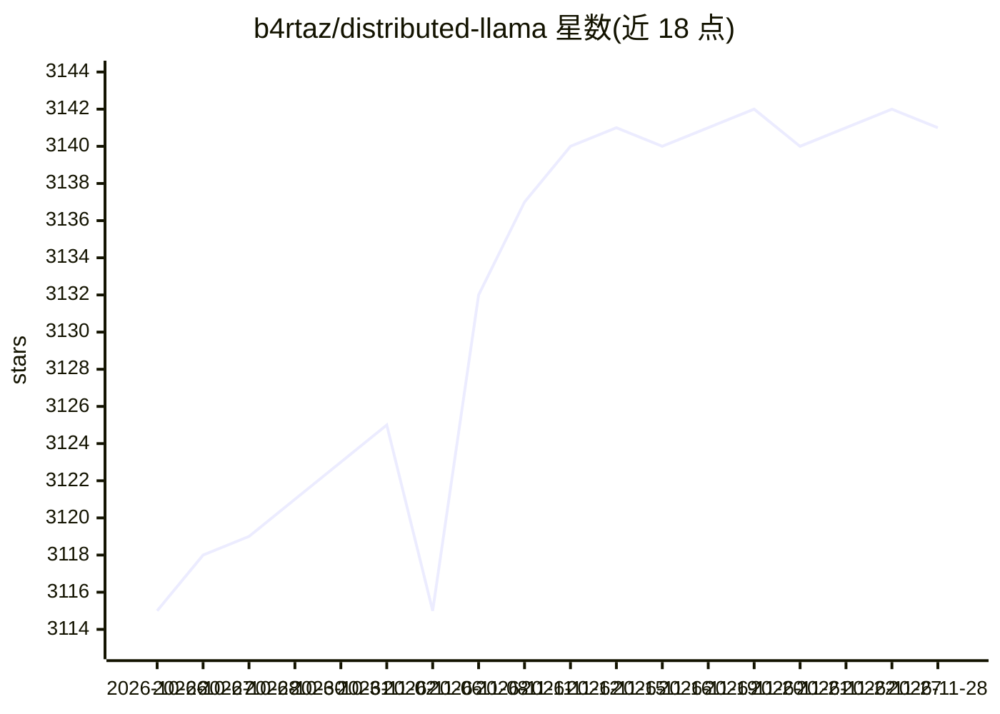

# b4rtaz/distributed-llama

⭐ 3,141 · C++ · MIT · 推送 2026-11-17 · [GitHub](https://github.com/b4rtaz/distributed-llama) · 个人维护

**把家用设备组成集群加速 LLM 推理的运行时**

基于张量并行与以太网高速同步的分布式 LLM 推理引擎：模型权重切分到根节点与 worker 节点，RAM 占用随节点数分摊，节点数为 2^n 且上限受模型 KV 头数约束。提供 dllama inference、chat、worker 与 API server 四个命令，支持 CPU（ARM/x86_64 AVX2）与实验性 Vulkan GPU，支持 q40/f32 量化。启动脚本需 Python 3 与 C++ 编译器，支持 Llama、DeepSeek Distill、Qwen 等模型。

## 筛选速览

| 维度 | 判定 | 备注 |
|---|---|---|
| AI 角色 | `ai-ecosystem` | LLM/agent 周边工具 |
| 许可风险 | `permissive` | MIT |
| 部署形态 | `None` |  |
| 模型依赖 | locked-api |  |
| 硬件要求 | — | 无带数字的原话,不猜 |
| 安装摩擦 | `low` | 无编译、无系统依赖或容器化 |
| 成熟度 | — | 结构信号不足 |

## 能力要点

- 张量并行将模型切分到多个节点分摊 RAM 与加速推理
- 提供推理基准、CLI 聊天与 API 服务器命令
- 支持 ARM 与 x86_64 AVX2 CPU 优化及实验性 Vulkan
- 单命令脚本下载模型与分词器并启动根节点

## 适用场景

- 把家里多台电脑/树莓聚合成集群跑大模型推理
- 在无 GPU 的 CPU 设备上分布式运行 70B 级模型
- 通过 API 服务器向局域网提供 LLM 服务

## 场景标签

`推理引擎` · 领域:训练与推理

## 证据(README 行号)

> L7: Connect home devices into a powerful cluster to accelerate LLM inference. More devices mean faster performance, leve
> L65: The project is split up into two parts:

## 星数曲线

2026-10-26 3,115 → 2026-11-28 3,141（+26）

---
*卡片 v1 · prompt 1.4 · 生成 2026-11-23 · 置信度 high · 依据 README sha `5c22ad29037c` · [字段定义](../../DATASET.md)*
