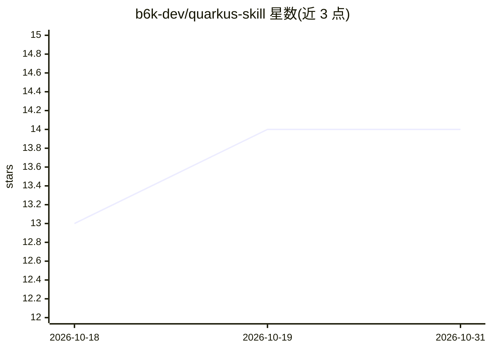

# b6k-dev/quarkus-skill

⭐ 14 · Shell · MIT · 推送 2026-03-24 · [GitHub](https://github.com/b6k-dev/quarkus-skill) · [官网](https://github.com/b6k-dev/quarkus-skill#readme) · 个人维护

**面向 AI 编程助手的 Quarkus 平台参考文档与可安装技能**

为 AI 编程助手提供 Quarkus 平台的参考文档与可安装 skill：覆盖 CDI 与依赖注入、配置、工具链流程及架构决策的实现指导与排障内容，以示例优先形式组织。技能可通过 npx skills add 命令或 install.sh 脚本安装到 Claude Code、Codex、Cursor、Gemini CLI、GitHub Copilot 等多种工具；安装后在 OpenCode 中经 /quarkus 命令加载，并可更新至最新版本。MIT 许可。

## 筛选速览

| 维度 | 判定 | 备注 |
|---|---|---|
| AI 角色 | `ai-knowledge` | 知识聚合/清单类 |
| 许可风险 | `permissive` | MIT |
| 部署形态 | `library` | 以包/库形式分发 |
| 模型依赖 | — | README 未给出锁定关系 |
| 硬件要求 | — | 无带数字的原话,不猜 |
| 安装摩擦 | `low` | 无编译、无系统依赖或容器化 |
| 成熟度 | — | 结构信号不足 |

## 能力要点

- Quarkus 平台参考文档与可安装 skill（CDI、配置、工具链、架构决策）
- 支持多种 AI 编程助手（Claude Code、Codex、Cursor、Gemini CLI 等）
- npx skills add 与 install.sh 两种安装途径，支持本地与全局安装
- /quarkus 命令加载与 --update-skill 更新机制

## 适用场景

- 让 AI 编程助手在 Quarkus 项目中获得实现与排障指导
- 通过 /quarkus 命令查询 CDI、配置等具体任务的参考内容
- 为团队常用的多种编码助手统一添加 Quarkus 技能

## 场景标签

 · 领域:软件开发/Java 生态知识

## 证据(README 行号)

> L1: # Quarkus Skill for AI Coding Assistants
> L3: Quarkus platform reference docs and installable skill for AI coding assistants, including OpenCode, Codex, Cursor, C
> L5: Use this repository to get concise, example-first guidance for building and troubleshooting Quarkus applications: CD

## 星数曲线

2026-10-18 13 → 2026-10-31 14（+1）

---
*卡片 v1 · prompt 1.4 · 生成 2026-10-31 · 置信度 high · 依据 README sha `860bf54cd52f` · [字段定义](../../DATASET.md)*
