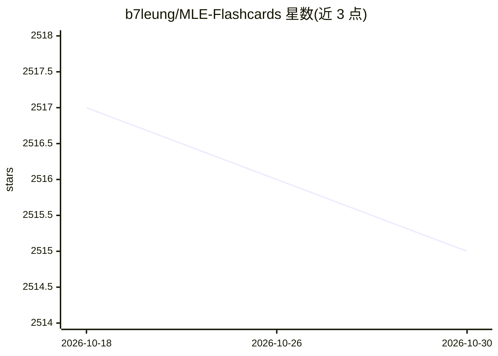

# b7leung/MLE-Flashcards

⭐ 2,515 · GPL-3.0 · 推送 2026-04-30 · [GitHub](https://github.com/b7leung/MLE-Flashcards) · 个人维护

**250+ 机器学习主题复习用闪卡集**

作者基于多年 ML 研究、课程与自学整理的 250+ 张闪卡，覆盖计算机科学、经典机器学习、现代深度学习、2D/3D 计算机视觉、NLP、强化学习与生成模型。面向已有 ML 基础的读者用于复习与查漏，或供初学者概览领域范围；README 明确说明部分主题覆盖程度不一、可能存在错误，且非权威资源。内容以幻灯片/图片形式呈现，另附 Stanford CS231n 等外部学习链接。

## 筛选速览

| 维度 | 判定 | 备注 |
|---|---|---|
| AI 角色 | `ai-knowledge` | 知识聚合/清单类 |
| 许可风险 | `viral` | GPL-3.0 |
| 部署形态 | `None` |  |
| 模型依赖 | — | README 未给出锁定关系 |
| 硬件要求 | — | 无带数字的原话,不猜 |
| 安装摩擦 | `low` | 无编译、无系统依赖或容器化 |
| 成熟度 | — | 结构信号不足 |

## 能力要点

- 250+ 张闪卡，作者自学整理
- 覆盖经典 ML、深度学习、2D/3D 视觉、NLP、强化学习、生成模型
- README 自述非权威资源、可能存在错误

## 适用场景

- 复习机器学习与计算机视觉知识点、查漏补缺
- 面试前快速过一遍 ML 技术要点
- 初学者概览 ML 领域主题范围

## 场景标签

`教程课程` · 领域:学习与行业

## 证据(README 行号)

> L3: 250+ flashcards I made as an exercise & reference for myself, after from years of ML research, coursework, & indepen
> L5: Topics covered includes: **computer science, classical ML, modern deep learning, 2D/3D computer vision, NLP, reinfor

## 星数曲线

2026-10-18 2,517 → 2026-10-30 2,515（-2）

---
*卡片 v1 · prompt 1.4 · 生成 2026-10-21 · 置信度 high · 依据 README sha `e5e79f72ffa4` · [字段定义](../../DATASET.md)*
