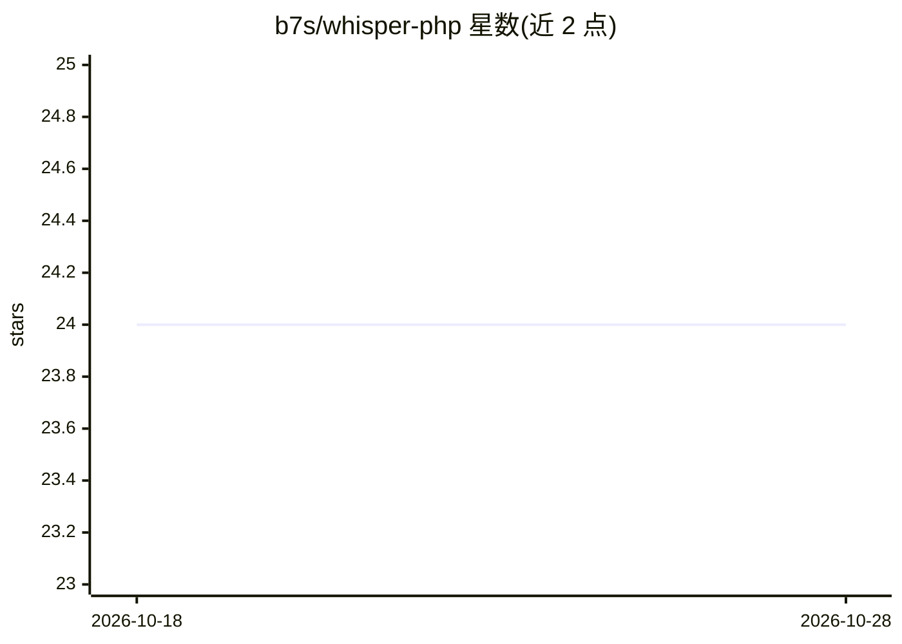

# b7s/whisper-php

⭐ 24 · PHP · MIT · 推送 2026-07-03 · [GitHub](https://github.com/b7s/whisper-php) · 个人维护

**PHP 库：在 PHP 应用中本地运行 Whisper.cpp 做语音转文字**

基于 Whisper.cpp 的独立 PHP 库，提供流式链式 API 完成本地语音转写：支持 99+ 语言、自动语言检测与指定、翻译为英文、说话人切换检测（实验性）、VAD 非语音过滤、beam search 解码、上下文词汇引导与音量语调分析，导出 SRT/VTT/JSON/CSV 格式。安装后通过 whisper-setup 命令下载并从源码编译 Whisper 二进制（优先 GPU，失败回退 CPU）、模型与 FFmpeg；本地处理，不调用外部 API。要求 PHP 8.2+ 与 Composer。

## 筛选速览

| 维度 | 判定 | 备注 |
|---|---|---|
| AI 角色 | `ai-native` | 本体是模型或模型工具 |
| 许可风险 | `permissive` | MIT |
| 部署形态 | `None` |  |
| 模型依赖 | — | README 未给出锁定关系 |
| 硬件要求 | — | 无带数字的原话,不猜 |
| 安装摩擦 | `high` | 编译与系统依赖俱全 |
| 成熟度 | — | 结构信号不足 |

## 能力要点

- 本地转写，无需 API 调用，处理全部在本机完成
- 支持 99+ 语言、自动检测、译至英文与指定语言
- 导出 SRT/VTT/JSON/CSV，含时间戳与说话人检测（实验性）
- VAD 过滤、beam search、上下文引导与音量语调（dBFS）分析

## 适用场景

- 在 PHP/Laravel 应用中为音频或视频生成字幕与文字记录
- 将多语言播客或客服录音译为英文文字
- 对含专业术语的医学/法务录音做术语引导转写

## 场景标签

`语音识别` · 领域:感知与多模态

## 证据(README 行号)

> L5: 🎙️ **Transform audio into text with Whisper.cpp AI - directly in PHP!**
> L7: A powerful, standalone PHP library that brings state-of-the-art speech recognition to your applications. Built on Wh

## 星数曲线

2026-10-18 24 → 2026-10-28 24（+0）

---
*卡片 v1 · prompt 1.4 · 生成 2026-10-27 · 置信度 high · 依据 README sha `afc6e95775a1` · [字段定义](../../DATASET.md)*
