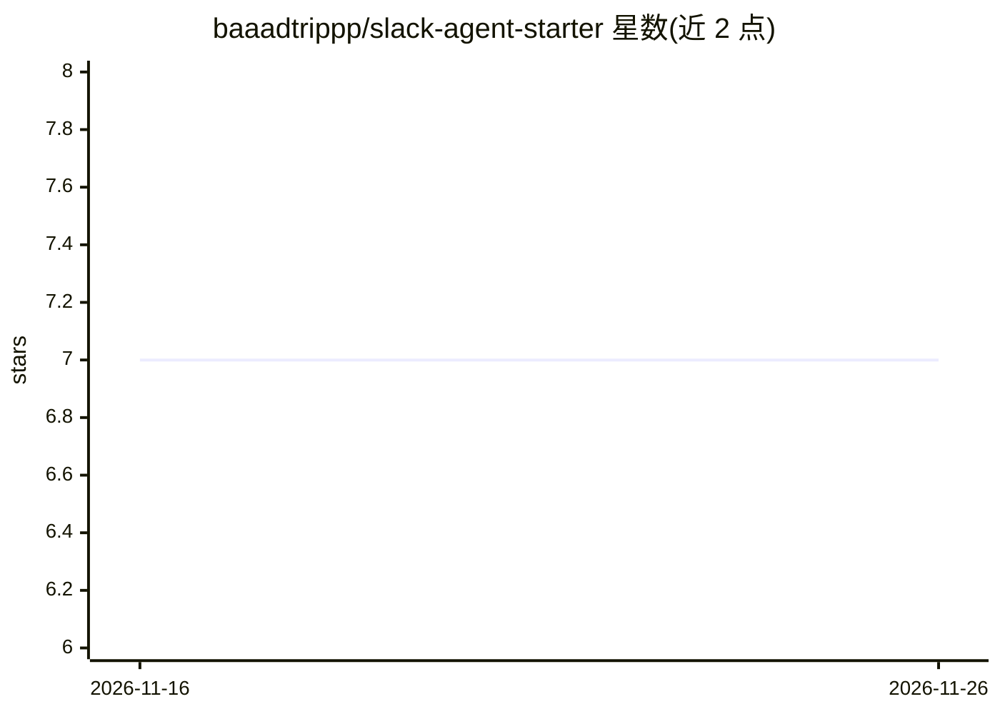

# baaadtrippp/slack-agent-starter

⭐ 7 · TypeScript · MIT · 推送 2026-11-18 · [GitHub](https://github.com/baaadtrippp/slack-agent-starter) · 个人维护

**在 Vercel 上运行自己的 Slack AI agent 参考实现**

参考实现（starter）：在 Slack 中 @机器人 即可触发运行于 Vercel Sandbox 的开源 Pi agent，答案回帖到线程，worker 关停后线程仍可继续对话。架构上将 gateway（基于 Chat SDK，运行于 Vercel Functions，状态存 Upstash Redis）与 worker 分离，Sandbox 空闲即停止、由持久化 Drive 恢复会话，密钥由 Sandbox 防火墙注入外发请求。支持文件/图片输入、生成文本文件输出、状态与停止按钮、用量统计。README 明言是供 fork 与阅读的参考实现，非加固产品；不支持私有频道/DM、除 OpenRouter 外的提供商，单次运行限 60 秒，文件上限 16 KiB。

## 筛选速览

| 维度 | 判定 | 备注 |
|---|---|---|
| AI 角色 | `ai-native` | 本体是模型或模型工具 |
| 许可风险 | `permissive` | MIT |
| 部署形态 | `None` |  |
| 模型依赖 | locked-api |  |
| 硬件要求 | — | 无带数字的原话,不猜 |
| 安装摩擦 | `low` | 无编译、无系统依赖或容器化 |
| 成熟度 | — | 结构信号不足 |

## 能力要点

- Slack mention 触发 Vercel Sandbox 中的 Pi agent，线程持续会话
- gateway 与 worker 分离：gateway 不运行模型，worker 不调用 Slack
- Sandbox 防火墙注入 API key，agent 无 shell、只读输入写单个文件
- 支持文件/图片/公开链接输入与每回答一个文本文件输出

## 适用场景

- 在 Slack 频道里让 agent 分析上传的 CSV 并回传清理后的文件
- 基于此 starter fork 出自己的 Slack 机器人 agent
- 在无 shell 的沙箱环境中让 agent 处理团队消息与文件

## 场景标签

`聊天机器人` · 领域:对话与助手

## 证据(README 行号)

> L3: Run your own AI agent in Slack on Vercel. Mention the bot in a channel, the
> L8: It is a reference implementation to fork and read, not a hardened product. You

## 星数曲线

2026-11-16 7 → 2026-11-26 7（+0）

---
*卡片 v1 · prompt 1.4 · 生成 2026-11-20 · 置信度 high · 依据 README sha `275992c86486` · [字段定义](../../DATASET.md)*
