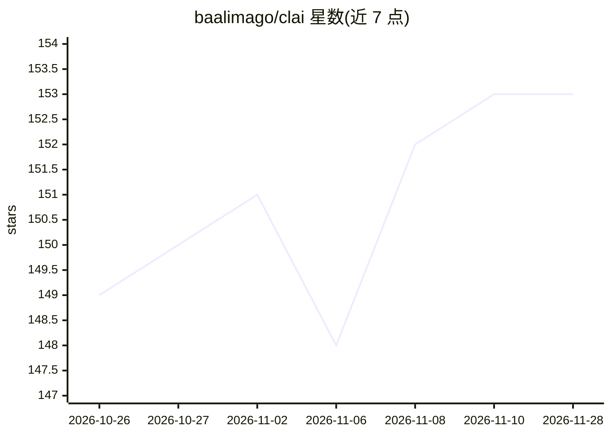

# baalimago/clai

⭐ 153 · Go · MIT · 推送 2026-11-25 · [GitHub](https://github.com/baalimago/clai) · 个人维护

**终端用户的命令行 LLM 代理工具，接入多厂商模型**

clai 是一个 Go 编写的 unix 风格命令行 agentic harness：将 shell 上下文注入系统提示，通过 API key 接入 Jev/OpenRouter/Ollama/OpenAI/Gemini/Anthropic 等厂商的模型，支持对话续接、模型回退、循环验证、JSON 结构化输出、MCP 服务器、图像双向传输与 git 风格的云同步。面向习惯管道与脚本操作的终端高级用户。安装提供 setup.sh、go install 与 Nix flake 三种方式，命令文档通过 man page 提供。

## 筛选速览

| 维度 | 判定 | 备注 |
|---|---|---|
| AI 角色 | `ai-ecosystem` | LLM/agent 周边工具 |
| 许可风险 | `permissive` | MIT |
| 部署形态 | `library` | 以包/库形式分发 |
| 模型依赖 | local-ok | 支持本地模型 |
| 硬件要求 | — | 无带数字的原话,不猜 |
| 安装摩擦 | `low` | 无编译、无系统依赖或容器化 |
| 成熟度 | — | 结构信号不足 |

## 能力要点

- shell 上下文注入与 unix 管道输入输出
- 动词化模型回退（strong/fast/cheap 按机器解析为有序列表）
- MCP 客户端与 Agent Skills 导入
- 8 家厂商接入，含图像输入输出与 -response-format 结构化输出

## 适用场景

- 在 shell 会话中通过管道向 LLM 提问并取回 stdout
- 用 -loop 配合 -check 让模型迭代到验证通过
- 多台机器间同步配置与对话记录
- 接入本地 Ollama 或云端 API 模型完成命令行任务

## 场景标签

`AI 助手` · 领域:对话与助手

## 证据(README 行号)

> L10:  <code>clai</code> ( /klaɪ/ , like "cli" in " cli mate") is a unix-like command line agentic harness with batteries
> L67: |Vendor|Environment Variable|Models|

## 星数曲线

2026-10-26 149 → 2026-11-28 153（+4）

---
*卡片 v1 · prompt 1.4 · 生成 2026-11-27 · 置信度 high · 依据 README sha `3207e760e94d` · [字段定义](../../DATASET.md)*
