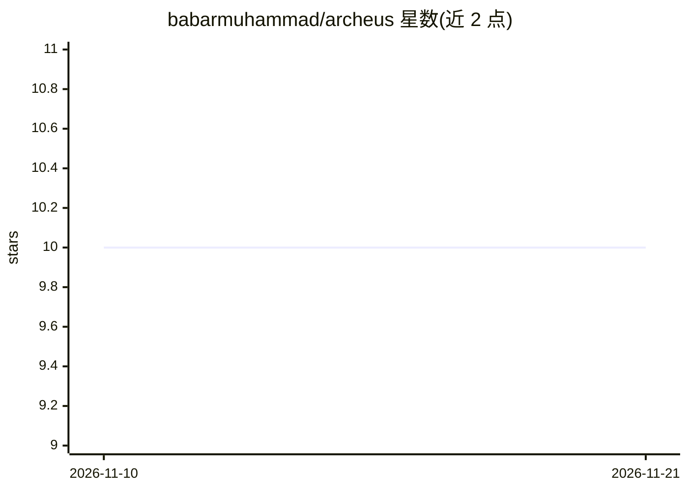

# babarmuhammad/archeus

⭐ 10 · Python · MIT · 推送 2026-11-16 · [GitHub](https://github.com/babarmuhammad/archeus) · [官网](https://claudectl.space/) · 个人维护

**AI 编码 agent 的记忆与工作区管理层**

面向终端编码 agent 的持久化记忆与工作区工具：维护按项目的语义记忆图（实体、关系、经验教训），以 ≤250 token 的常驻索引加按需注入的方式控制上下文开销；提供会话浏览（搜索/标签/分叉/恢复/归档）、逐日 token 用量统计、依赖图查看，以及启动前健康检查等辅助功能。通过终端 TUI、桌面 GUI 与 Claude Code 插件三种界面使用，纯 Python 标准库实现，无运行时第三方依赖，需 Python 3.10+ 与 Claude Code CLI。

## 筛选速览

| 维度 | 判定 | 备注 |
|---|---|---|
| AI 角色 | `ai-ecosystem` | LLM/agent 周边工具 |
| 许可风险 | `permissive` | MIT |
| 部署形态 | `library` | 以包/库形式分发 |
| 模型依赖 | local-ok | 支持本地模型 |
| 硬件要求 | — | 无带数字的原话,不猜 |
| 安装摩擦 | `low` | 无编译、无系统依赖或容器化 |
| 成熟度 | — | 结构信号不足 |

## 能力要点

- 按项目的语义记忆图，任务范围、预算化的上下文注入（常驻索引 ≤250 tok，prompt hook 默认 ≤600 tok）
- 全量会话管理：搜索、标签、分叉、恢复、归档，跨多账户
- 从本地转录读取 token 用量统计，含 Plan→Execute 的廉价模型执行路径
- 零运行时依赖，提供终端 UI 与桌面 GUI

## 适用场景

- 让编码 agent 在会话之间保留项目记忆与经验教训
- 控制大项目中每次加载 CLAUDE.md 带来的 token 开销
- 统一浏览和管理跨项目、跨账户的历史 agent 会话

## 场景标签

`Agent 记忆` · 领域:Agent 开发

## 证据(README 行号)

> L8:  The memory and workspace layer for AI coding agents.
> L43: permissions and context you meant. Underneath, it maintains a semantic memory
> L46: Claude Code is the agent it drives today. It is a terminal UI and a desktop
> L69: PATH or at `~/.local/bin/`). No API key — it uses the Claude Code auth you

## 星数曲线

2026-11-10 10 → 2026-11-21 10（+0）

---
*卡片 v1 · prompt 1.4 · 生成 2026-11-19 · 置信度 high · 依据 README sha `884122b14b8c` · [字段定义](../../DATASET.md)*
