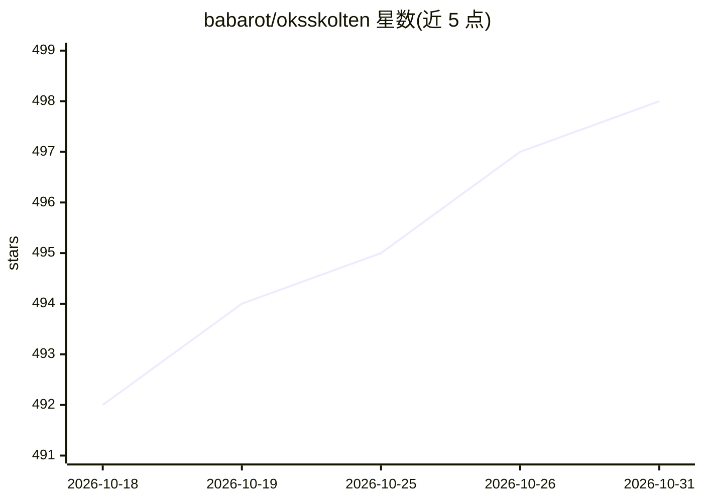

# babarot/oksskolten

⭐ 498 · TypeScript · AGPL-3.0 · 推送 2026-10-09 · [GitHub](https://github.com/babarot/oksskolten) · [官网](https://oksskolten.com) · 个人维护

**AI 原生自托管 RSS 阅读器：默认抓取全文并做摘要与翻译**

自托管的 RSS 阅读器，核心差异是默认对每篇文章抓取原文并用 Readability 加约 500 条去噪规则提取全文、转为 Markdown 本地存储。基于全文提供按需 AI 摘要与翻译（Anthropic/Gemini/OpenAI，SSE 流式）、基于 MCP 工具的多轮对话（可检索文章库）、Meilisearch 全文搜索、PWA 离线阅读。技术栈为 Node.js 22 + Fastify、React 19、SQLite（libsql）、单容器 Docker 部署，提供 Passkey/GitHub OAuth 认证与 FlareSolverr 反爬回退。

## 筛选速览

| 维度 | 判定 | 备注 |
|---|---|---|
| AI 角色 | `ai-enhanced` | 去掉 AI 部分产品仍成立 |
| 许可风险 | `viral` | AGPL-3.0 |
| 部署形态 | `self-host` | docker 或自建部署 |
| 模型依赖 | locked-api |  |
| 硬件要求 | — | 无带数字的原话,不猜 |
| 安装摩擦 | `low` | 无编译、无系统依赖或容器化 |
| 成熟度 | — | 结构信号不足 |

## 能力要点

- 每篇文章默认抓取原文并经 Readability + 500 条去噪规则提取全文
- 基于全文的 AI 摘要与翻译（Anthropic/Gemini/OpenAI，SSE 流式）
- MCP 多轮对话：搜索、统计、就订阅内容提问
- 单 Docker 容器部署（API/SPA/cron 调度），Meilisearch 全文搜索

## 适用场景

- 自托管一个不需点回原文站的完整阅读体验
- 对订阅文章做 AI 摘要、翻译和对话式问答
- 在 NAS 或树莓派上单容器运行自托管阅读器

## 场景标签

`文档问答` · 领域:知识与检索

## 证据(README 行号)

> L29: - **Full-Text Extraction** — Every article is fetched from its source and processed through Readability + 500 noise
> L30: - **AI Summarization & Translation** — On-demand article processing via Anthropic, Gemini, or OpenAI with SSE strea
> L31: - **Interactive Chat** — Multi-turn AI conversations with MCP tooling; search articles, get stats, and ask question

## 星数曲线

2026-10-18 492 → 2026-10-31 498（+6）

---
*卡片 v1 · prompt 1.4 · 生成 2026-10-21 · 置信度 high · 依据 README sha `090d8f1cdab1` · [字段定义](../../DATASET.md)*
