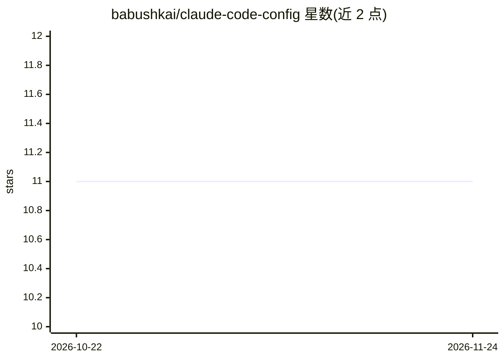

# babushkai/claude-code-config

⭐ 11 · Shell · 推送 2026-03-11 · [GitHub](https://github.com/babushkai/claude-code-config) · 个人维护

**为 Claude Code 提供生产环境默认配置集，一键部署**

面向生产环境的 Claude Code 默认配置集合，覆盖 7 个配置层：CLAUDE.md 项目指示书、模块化 Rules（代码风格/测试/安全/Git 规范）、基于最小权限原则的 settings.json 权限控制、6 个生命周期 Hooks（危险命令拦截、保存时 ESLint/Prettier 自动执行、会话审计日志）、5 个自定义 Skills（PR 审查、Issue 修复、部署等）、security-reviewer 子代理，以及 MCP 外部工具配置模板。通过安装脚本或手动复制到目标项目即可启用，MIT 许可。

## 筛选速览

| 维度 | 判定 | 备注 |
|---|---|---|
| AI 角色 | `ai-knowledge` | 知识聚合/清单类 |
| 许可风险 | `none` | — |
| 部署形态 | `None` |  |
| 模型依赖 | — | README 未给出锁定关系 |
| 硬件要求 | — | 无带数字的原话,不猜 |
| 安装摩擦 | `low` | 无编译、无系统依赖或容器化 |
| 成熟度 | — | 结构信号不足 |

## 能力要点

- 7 层配置结构：CLAUDE.md、Rules、权限、Hooks、Skills、Agents、MCP
- PreToolUse/PostToolUse/Stop/SessionStart 六种生命周期钩子预设
- 最小权限 settings.json：允许只读与 git 非破坏操作，拒绝 rm -rf/sudo/force push
- 内置 /review-pr、/fix-issue、/deploy 等自定义命令与 security-reviewer 子代理

## 适用场景

- 新项目快速引入团队级 Claude Code 安全护栏与编码规范
- 限制 AI 执行危险 shell 命令与敏感文件读写
- 统一团队成员的 Claude Code 权限、钩子与工作流配置

## 场景标签

 · 领域:开发工具/AI 编程辅助配置

## 证据(README 行号)

> L3: Claude Code の本番運用向けデフォルト設定集。任意のプロジェクトにコピーするだけで、セキュリティガードレール・自動lint・カスタムスキル・チーム標準を即座に導入できます。
> L32: 本リポジトリは、記事で解説されている Claude Code の7つの設定レイヤーをカバーしています。

## 星数曲线

2026-10-22 11 → 2026-11-24 11（+0）

---
*卡片 v1 · prompt 1.4 · 生成 2026-11-18 · 置信度 high · 依据 README sha `b12952b5ce4d` · [字段定义](../../DATASET.md)*
