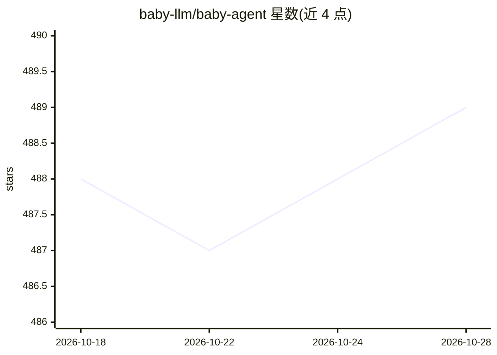

# baby-llm/baby-agent

⭐ 489 · Go · Apache-2.0 · 推送 2026-06-08 · [GitHub](https://github.com/baby-llm/baby-agent) · 组织维护 · 中文 README

**Go 语言 AI Agent 教学仓库：面向无 LLM 背景的后端工程师**

用 Go 1.24+ 从零实现 Agent 框架关键原理的教学仓库，面向具备 Golang 基础但无 LLM 背景的后端工程师。十二章循序渐进覆盖 Chat Completions/SSE、Function Calling、Agent Loop、MCP 协议、上下文工程、记忆系统、Agentic RAG（pgvector 向量存储）、Docker 沙盒 Guardrails、技能插件、Web 服务化与可观测性。各章可独立 go run 运行；明确声明不建议直接用于生产环境二次开发，第十一、十二章为规划中内容。

## 筛选速览

| 维度 | 判定 | 备注 |
|---|---|---|
| AI 角色 | `ai-knowledge` | 知识聚合/清单类 |
| 许可风险 | `permissive` | Apache-2.0 |
| 部署形态 | `None` |  |
| 模型依赖 | — | README 未给出锁定关系 |
| 硬件要求 | — | 无带数字的原话,不猜 |
| 安装摩擦 | `low` | 无编译、无系统依赖或容器化 |
| 成熟度 | — | 结构信号不足 |

## 能力要点

- 十二章可运行代码覆盖 Tool Calling、MCP、Memory、Agentic RAG、Guardrails 等 Agent 机制
- Agentic RAG 章节实现 Embedding 索引、pgvector 向量存储、召回与重排序
- Docker 沙盒隔离与 Human-in-the-loop 确认机制
- 各章代码独立运行，支持 OpenAI/DeepSeek/GLM 等 API Key

## 适用场景

- 后端工程师系统学习 Agent 框架的工程实现原理
- 作为 Agent 业务的原理参考与原型验证起点
- 用 Go 学习 MCP、RAG、可观测性等 Agent 子系统设计

## 场景标签

`教程课程` · 领域:学习与行业

## 证据(README 行号)

> L11: > - 本项目是**教学仓库**：目标是用可运行的代码把 Agent、Tool Calling、Agent Loop、MCP、Memory、RAG 等机制讲清楚。
> L12: > - 本项目**不是**“开箱即用的生产框架”，也**不建议直接用于生产环境的二次开发**。
> L25: 我们将按照"从基础调用到复杂 Agent"的顺序逐步深入，带你完成从零到复杂 Agent 的蜕变。每一阶段都包含可运行的代码示例。

## 星数曲线

2026-10-18 488 → 2026-10-28 489（+1）

---
*卡片 v1 · prompt 1.4 · 生成 2026-10-21 · 置信度 high · 依据 README sha `e88f7a14fabb` · [字段定义](../../DATASET.md)*
